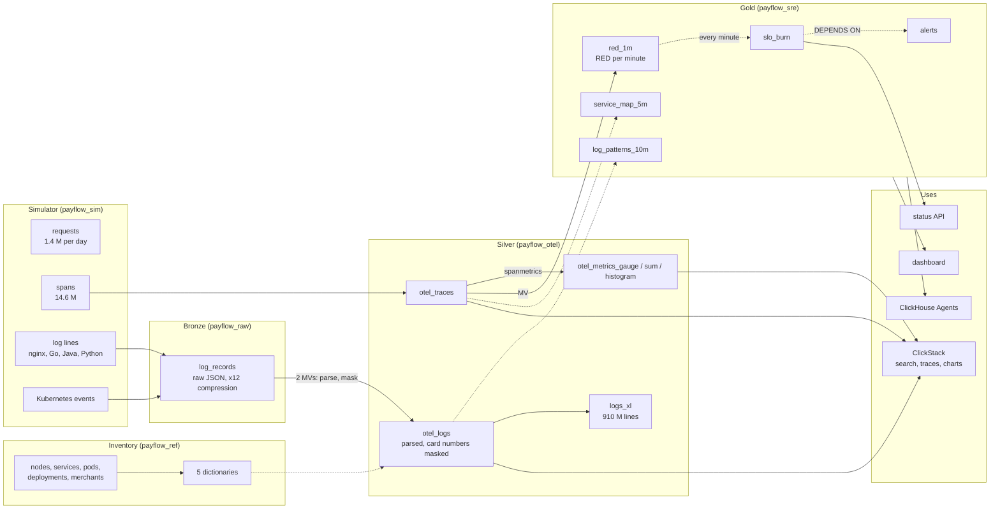

# ClickHouse from zero to advanced · Observability workshop

Black Friday on **PayFlow**, a payment platform running on Kubernetes. At 13:58 a release cuts the database connection pool from 50 to 10. Payments start failing, retries pile up, a pod is killed for lack of memory. You will collect, model and query every signal of that day on **your own ClickHouse Cloud service**, then run the investigation in SQL and in ClickStack, the observability UI of ClickHouse.

Logs, traces, metrics and Kubernetes events are **simulated in SQL** (no collector, no load generator, nothing to install) and deterministic: everyone gets the same numbers. They follow the OpenTelemetry schema exactly, so ClickStack reads them as if a real collector had written them.

```
 container logs ──► bronze ──MV──► silver (OpenTelemetry) ──MV / refreshable views──► gold ──► ClickStack
 k8s events        raw JSON       otel_logs, otel_traces,      RED, SLO burn rate,          dashboards
 traces, metrics   (untouched)    otel_metrics_*               alerts, service map          API, AI agent
```

---

## The architecture of the workshop

Every arrow is SQL running inside ClickHouse. Solid arrow: incremental materialized view, triggered by each INSERT. Dotted arrow: refreshable materialized view, recomputed on a schedule.



| Layer | Tables | What it shows |
|---|---|---|
| **Inventory** | `payflow_ref.*`: 12 nodes, 9 services, 49 pods, the deployment history, 20,000 merchants | the context every signal is joined to |
| **Bronze** | `payflow_raw.log_records` | raw container log lines and Kubernetes events, untouched, as the agents ship them |
| **Silver** | `otel_logs`, `otel_traces`, `otel_metrics_gauge`, `otel_metrics_sum`, `otel_metrics_histogram` | the OpenTelemetry exporter schema; logs parsed from 4 formats, card numbers masked |
| **Gold** | `red_1m`, `slo_burn`, `alerts`, `service_map_5m`, `log_patterns_10m` | what an SRE watches, a few MB for the whole day |
| **Uses** | ClickStack, SQL console dashboard, Query API endpoint, ClickHouse Agents | everything reads ClickHouse directly |

---

## Before the session (20 min, the day before)

1. **Create your ClickHouse Cloud account** on [clickhouse.cloud](https://clickhouse.cloud). You get $300 of credits, far more than the day needs.
2. **Create a service** with this configuration:

   | Setting | Value | Why |
   |---|---|---|
   | Region | AWS **eu-central-1** (or the closest to you) | |
   | Replicas | **3** | the big scans are spread across the 3 (module 6) |
   | Memory per replica | **64 GB** (16 vCPU), **minimum = maximum** | fixed size: no waiting for autoscaling during a demo |
   | Idling | **after 1 hour** of inactivity, at least | the service does not sleep during a break |

   Indicative cost: about $11 per hour at most with this size, under $70 for the day. The calculator on [clickhouse.com/pricing](https://clickhouse.com/pricing) gives the exact rate.
3. **Open the SQL console** of the service and run `SELECT version()`.
4. Optional, to catch up from the command line: install the native client (`curl https://clickhouse.com/ | sh`).

Each SQL file is run in the SQL console, statement by statement or all at once. Every statement stays under 60 seconds. Every file ends with a checkpoint that must show `OK` everywhere.

---

## Schedule (5 hours)

| Time | Module | Content | Duration |
|---|---|---|---|
| 0:00 | **00** First steps | a million log lines generated, parsed and aggregated in one query | 10 min |
| 0:10 | **01** Fundamentals | MergeTree, ORDER BY, LowCardinality; the inventory: nodes, services, pods, deployments, merchants | 25 min |
| 0:35 | **02** Bronze | the SQL simulator, 6 million raw log lines in 25 s, JSON exploration, a PCI problem | 35 min |
| 1:10 | **03** Silver | the OpenTelemetry tables, the log pipeline (4 formats, severity, trace ids, card masking), traces, metrics | 40 min |
| 1:50 | break | | 10 min |
| 2:00 | **04** Dictionaries | team, node, merchant, and "which change was live at that moment" | 20 min |
| 2:20 | **05** Gold | RED metrics, SLO burn rate, alerts, service map from traces, log patterns | 35 min |
| 2:55 | **06** Performance | 910 M log lines: text index, bloom filter, projection, query caches, 3 replicas | 30 min |
| 3:25 | break | | 10 min |
| 3:35 | **07** Investigation | from the page to the root cause in 10 queries, the cost of the incident, replay, GDPR, security | 40 min |
| 4:15 | **08** ClickStack and agents | the same investigation in ClickStack, a dashboard, a status API, ClickHouse Agents | 45 min |

---

## Catch-up

Fallen behind, or a module failed? The `run_all.sh` script replays the files with the native client, from your machine, in the `en/` folder:

```bash
cd en
export CH_HOST=<your-service>.<region>.clickhouse.cloud
export CH_PASSWORD='<password>'
```

```bash
./run_all.sh 01 04
```
Replays modules 01 to 04, without reset.

```bash
./run_all.sh 05_gold
```
Resumes from a module to the end.

```bash
./run_all.sh
```
Everything from scratch, reset included: about 10 minutes.

`reset.sql` removes only what the workshop created: the `payflow_*` databases, user and roles, and the `pf_*` functions.

---

## Lexicon

| Term | Meaning | Term | Meaning |
|---|---|---|---|
| **Log** | a timestamped line written by a program | **Span** | one operation of a request (an HTTP call, a query), with a start and a duration |
| **Trace** | the tree of spans of one request, across services | **TraceId / SpanId** | the identifiers that link logs and spans |
| **Metric** | a number measured over time: gauge (a value), sum (a counter), histogram (a distribution) | **OpenTelemetry (OTel)** | the open standard for logs, traces and metrics |
| **RED** | Rate, Errors, Duration: the three numbers of a service | **SLO** | service level objective, e.g. 99.95% of payments succeed |
| **Error budget** | the errors the SLO allows (0.05% here) | **Burn rate** | how fast the budget is spent; 14.4 = a month's budget in 2 days |
| **Exemplar** | the trace id kept with a metric point, to jump from a chart to a trace | **Service map** | who calls whom, rebuilt from parent and child spans |
| **ClickStack** | the ClickHouse observability stack: ClickHouse, OpenTelemetry collector, HyperDX UI | **HyperDX** | the UI of ClickStack: search, traces, dashboards, alerts |
| **Pod / node** | a running container group / the machine that hosts it | **Rollout / rollback** | replacing pods with a new version / going back |
| **OOMKilled** | killed by the kernel for using more memory than allowed | **HikariCP** | the Java database connection pool; its size is the root cause here |
| **PAN** | primary account number: the card number, never to be logged in clear (PCI DSS) | **MV / RMV** | incremental materialized view / refreshable materialized view |
| **Text index** | an index of the words of a column, for full-text search | **Bloom filter** | a compact index that says "certainly not in this granule" |
| **Projection** | a second, pre-sorted or pre-aggregated copy of a table, chosen automatically | **Granule** | the unit ClickHouse reads: 8,192 rows |

---

## Repository contents

```
00_introduction/                 first steps
01_fundamentals/                 databases, MergeTree, the platform inventory
02_bronze/                       the SQL simulator, raw ingestion, JSON exploration
03_silver/                       OpenTelemetry tables, log pipeline, traces and metrics
04_dictionaries/                 enrichment in memory, "which change was live"
05_gold/                         RED, SLO and alerts, service map and log patterns
06_performance/                  a billion log lines, indexes, projections, replicas
07_investigation/                the incident, step by step; operations
08_clickstack_dashboards_agent/  step-by-step README: ClickStack, dashboard, API, agent (no SQL file)
run_all.sh, reset.sql            full run and cleanup
RESULTS.md                       numbers measured on the test service, module by module
```

## ClickHouse best practices illustrated

| Rule | Where |
|---|---|
| Choose ORDER BY from the most frequent filters (`schema-pk-plan-before-creation`) | modules 1, 3 |
| LowCardinality for repeated strings, no Nullable | modules 1, 3 |
| Incremental materialized views for ingestion and rollups (`mv-incremental`) | modules 3, 5 |
| Refreshable materialized views for windows and joins, `DEPENDS ON`, `SYSTEM WAIT VIEW` | module 5 |
| Dictionaries instead of joins for enrichment (`query-join-use-dictionaries`) | module 4 |
| Skip indexes (text, bloom filter) and projections declared in the CREATE | module 6 |
| Lightweight DELETE and partition operations instead of mutations | module 7 |
| Comments on tables and columns for agents (`agent-discovery-schema`) | module 8 |
