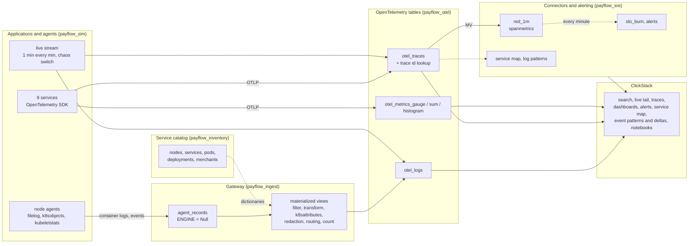

# ClickHouse from zero to advanced · Observability workshop

Black Friday on **PayFlow**, a payment platform running on Kubernetes. At 13:58 a release cuts the database connection pool from 50 to 10. Payments start failing, retries pile up, a pod is killed for lack of memory. You collect every signal of that day on **your own ClickHouse Cloud service**, explore it in **ClickStack** (search, dashboards, alerts, service map, event patterns, AI notebooks), and see underneath, in SQL, how each feature works.

Logs, traces, metrics and Kubernetes events are **simulated in SQL**: no collector, no load generator, nothing to install. They follow the OpenTelemetry schema of the ClickHouse exporter exactly, so ClickStack reads them as if a real collector had written them. Everything is deterministic: everyone gets the same numbers. A live stream replays traffic every minute, and a switch lets you break production on purpose.

---

## The architecture: the path of the telemetry

The workshop follows the path of real telemetry, with the vocabulary of the OpenTelemetry collector and of ClickStack. What a collector would do at the edge, the gateway does inside ClickHouse, with materialized views: the approach the ClickHouse documentation recommends for heavy processing.



| Database | Role | Tables |
|---|---|---|
| `payflow_sim` | the applications and their agents, simulated in SQL; the live stream | views, the chaos switch |
| `payflow_ingest` | the landing table of the collector gateway (stores nothing) | `agent_records` |
| `payflow_otel` | what the ClickHouse exporter writes: the sources of ClickStack | `otel_logs`, `otel_traces`, `otel_metrics_*`, trace lookup, rollups |
| `payflow_sre` | what the connectors and the alerting compute | `red_1m`, `slo_burn`, `alerts`, `service_map_5m`, `log_patterns_10m`, `log_volume_1m` |
| `payflow_inventory` | the service catalog, loaded in memory as dictionaries | `node`, `service`, `pod`, `deployment_history`, `merchant` |

---

## Before the session (20 min, the day before)

1. **Create your ClickHouse Cloud account** on [clickhouse.cloud](https://clickhouse.cloud). You get $300 of credits, far more than the day needs.
2. **Create a service** with this configuration:

   | Setting | Value | Why |
   |---|---|---|
   | Region | AWS **eu-central-1** (or the closest to you) | |
   | Replicas | **3** | the big scans are spread across the 3 (module 7) |
   | Memory per replica | **64 GB** (16 vCPU), **minimum = maximum** | fixed size: no waiting for autoscaling during a demo |
   | Idling | **after 1 hour** of inactivity, at least | the service does not sleep during a break |

   Indicative cost: about $11 per hour at most with this size, under $70 for the day. The calculator on [clickhouse.com/pricing](https://clickhouse.com/pricing) gives the exact rate.
3. **Open the SQL console** of the service and run `SELECT version()`. Then open **ClickStack** from the left menu once, to check that it is available on your service.
4. Optional, to catch up from the command line: install the native client (`curl https://clickhouse.com/ | sh`).

Each SQL file is run in the SQL console, statement by statement or all at once. Every statement stays under 60 seconds. Every file ends with a checkpoint that must show `OK` everywhere. Each module with a ClickStack part has a README with the steps in the UI.

---

## Schedule (5 hours)

| Time | Module | ClickStack | SQL underneath | Duration |
|---|---|---|---|---|
| 0:00 | **00** First steps | | a million log lines generated, parsed, aggregated in one query | 10 min |
| 0:10 | **01** Data model | | the service catalog and its dictionaries; the OpenTelemetry tables, exactly as the exporter creates them | 25 min |
| 0:35 | **02** Collection | | the applications and agents, the gateway (Null table and processors as views: parsing, enrichment, card masking, filter, count), OTLP traces and metrics, the live stream | 40 min |
| 1:15 | **03** Search and correlation | sources, Lucene and SQL search, saved search, live tail, log to trace to pod; three investigations, from a log, a metric alert, a trace | the text indexes, EXPLAIN, the three scenarios in SQL | 45 min |
| 2:00 | break | | | 10 min |
| 2:10 | **04** Dashboards | Chart Explorer, a dashboard with filters, release markers, row-click drilldown, SQL tiles, presets, text-to-chart | RED rollups (spanmetrics), the latency histogram with exemplars | 35 min |
| 2:45 | **05** SLOs and alerts | search, chart and SQL alerts, a webhook; **break production and get paged** | error budget, burn rate, multi-window alerting | 30 min |
| 3:15 | **06** Investigation | service map, event patterns, event deltas, release markers, infrastructure tab | the 10 questions, the trace as a tree, the cost of the incident | 40 min |
| 3:55 | break | | | 10 min |
| 4:05 | **07** Scale and cost | a rollup registered on the source | 875 M log lines: text index, bloom filter, projection, caches, 3 replicas; retention, sampling, sizing | 35 min |
| 4:40 | **08** AI and governance | AI notebooks, MCP, RBAC | ClickHouse Agents, row policies, GDPR delete, a status API | 20 min |

---

## Catch-up

Fallen behind, or a module failed? The `run_all.sh` script replays the SQL files with the native client, from your machine, in the `en/` folder:

```bash
cd en
export CH_HOST=<your-service>.<region>.clickhouse.cloud
export CH_PASSWORD='<password>'
```

```bash
./run_all.sh 01 04
```
Replays modules 01 to 04, without reset.

```bash
./run_all.sh 05_slos
```
Resumes from a module to the end.

```bash
./run_all.sh
```
Everything from scratch, reset included: about 10 minutes.

At the end of the day, run `stop_live_stream.sql`: the live stream refreshes every minute and keeps the service awake. `reset.sql` removes only what the workshop created: the `payflow_*` databases, user and roles, and the `pf_*` functions.

---

## Lexicon

| Term | Meaning | Term | Meaning |
|---|---|---|---|
| **Signal** | a kind of telemetry: logs, traces, metrics (and sessions in ClickStack) | **Wide event** | a rich record with many attributes, high cardinality allowed |
| **Resource / attributes** | who emitted (service, pod, node) / the details of the event | **Span / trace** | one operation of a request / the tree of spans of one request |
| **Collector** | the OpenTelemetry agent or gateway: receivers, processors, exporters, connectors | **Agent / gateway** | a collector on each node / a central collector that processes and exports |
| **Processor** | a step of the collector: filter, transform, k8sattributes, redaction, batch | **Connector** | turns one signal into another: spanmetrics (RED), servicegraph, count |
| **ClickStack** | the ClickHouse observability stack: ClickHouse, the collector, the HyperDX UI | **Source** | in ClickStack, a table declared as logs, traces or metrics |
| **RED** | Rate, Errors, Duration: the three numbers of a service | **SLO / error budget** | 99.95% of payments succeed / the 0.05% of errors allowed |
| **Burn rate** | how fast the budget is spent; 14.4 = a month's budget in 2 days | **Exemplar** | the trace id kept with a metric point, to jump from a chart to a trace |
| **Event patterns / deltas** | log lines clustered into messages / what makes slow spans different | **Release marker** | the line on a chart where a new version first appears |
| **HikariCP** | the Java database connection pool; its size is the root cause here | **OOMKilled** | killed by the kernel for using more memory than allowed |
| **PAN** | the card number, never to be stored in clear (PCI DSS) | **Null engine** | a table that stores nothing; its materialized views see every insert |
| **MV / RMV** | incremental materialized view / refreshable materialized view | **Text index / bloom filter** | an index of the words of a column / "certainly not in this granule" |

---

## Repository contents

```
00_first_steps/             a million log lines in one query
01_data_model/              the service catalog and its dictionaries, the OpenTelemetry tables
02_collection/              simulator, gateway pipeline, OTLP traces and metrics, live stream
03_search_and_correlation/  ClickStack search, three correlation scenarios (README) and the SQL underneath
04_dashboards/              ClickStack dashboards (README) and the RED rollups
05_slos_and_alerts/         ClickStack alerts and the chaos switch (README), SLO burn rate in SQL
06_investigation/           the incident in ClickStack (README), service map, patterns, 10 questions
07_scale_and_cost/          a billion log lines, indexes and caches, rollups, retention, sampling
08_ai_and_governance/       AI notebooks, MCP, ClickHouse Agents, RBAC, status API (README); rights and GDPR
run_all.sh, reset.sql       full run and cleanup
stop_live_stream.sql        stop the live stream at the end of the day
RESULTS.md                  numbers measured on the test service, module by module
```

## Best practices illustrated

| Rule | Where |
|---|---|
| Use the exporter's schema: ClickStack reads it as is | module 1 |
| Heavy processing in the database: Null table and materialized views | module 2 |
| Dictionaries for enrichment (`query-join-use-dictionaries`) | modules 1, 2, 6 |
| Incremental materialized views for rollups (`mv-incremental`); refreshable views for windows and joins | modules 4, 5, 6 |
| Rollups registered on the source, aggregate columns named `<function>__<column>` | module 7 |
| Text indexes, bloom filters, projections declared in the CREATE | modules 1, 7 |
| Retention by whole partitions (`ttl_only_drop_parts`), sampling that keeps the right traces | module 7 |
| Comments on tables and columns for agents (`agent-discovery-schema`) | module 8 |
