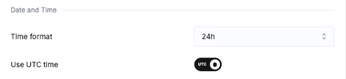
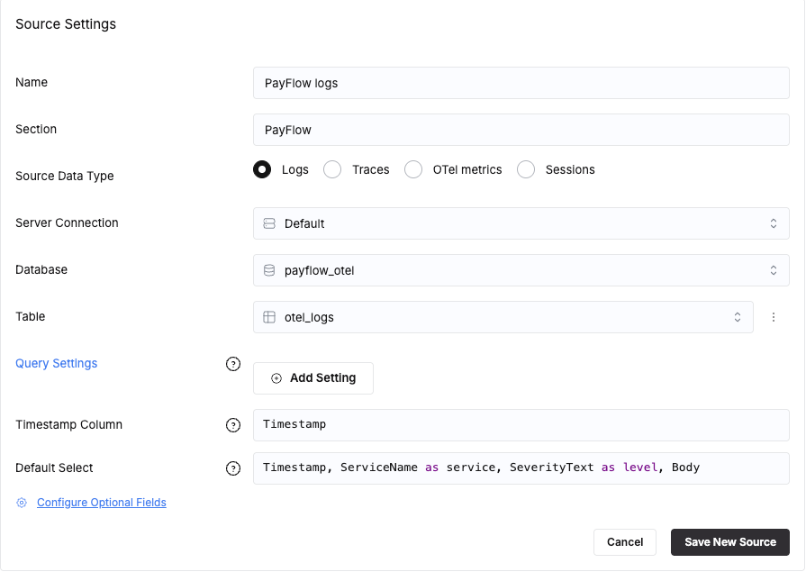
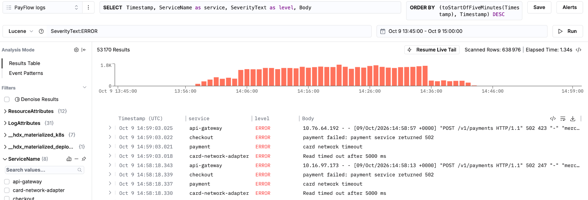
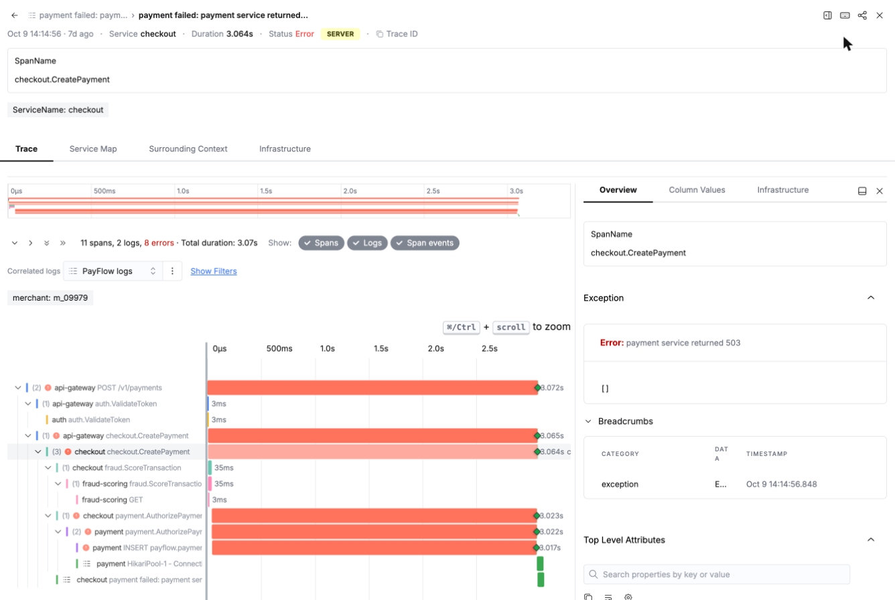
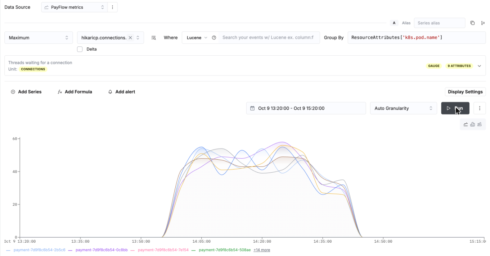

# Módulo 3 · Búsqueda y correlación en ClickStack

El mes de PayFlow ya está en las tablas OpenTelemetry, y un flujo en directo añade el minuto actual cada minuto. Ahora lo miras como lo hace un ingeniero de guardia, en **ClickStack**, la interfaz de observabilidad que viene con tu servicio ClickHouse Cloud. No hace falta conocer ClickStack: cada clic está descrito. Después, dos ficheros SQL muestran lo que ClickStack ejecuta por ti.

Duración: 45 min.

| Fichero | Contenido |
|---|---|
| `01_bajo_el_capo.sql` | la búsqueda en SQL, los índices de texto y EXPLAIN, de log a traza y a métricas del pod, live tail |
| `02_escenarios_de_correlacion.sql` | tres investigaciones: desde un log, desde una alerta de métrica, desde una traza |

---

## Paso 0 · Tu fecha de Black Friday (1 min)

Los datos dependen del día en que haces el taller: Black Friday es **el último viernes antes de hoy**. En la consola SQL, ejecuta:

```sql
SELECT pf_black_friday() AS black_friday, pf_day(-29) AS month_starts, now() AS now_utc;
```

Apunta la fecha. En todo lo que sigue, **el incidente** significa esa fecha, de 13:20 a 15:20 UTC. Las capturas de esta guía se hicieron con un Black Friday el 9 de octubre: tus fechas cambian, las curvas son las mismas.

---

## Paso 1 · Abrir ClickStack (2 min)

1. En la [consola de ClickHouse Cloud](https://console.clickhouse.cloud), abre tu servicio.
2. En el menú de la izquierda, cerca del final, haz clic en **ClickStack**. Se abre en una pestaña nueva del navegador (`hyperdx.clickhouse.cloud`), ya conectado a tu servicio: sin usuario, sin contraseña, sin instalación.

El menú de la izquierda de ClickStack es el mapa de este taller:

| Menú | Qué es | Módulo |
|---|---|---|
| **Search** | buscar y recorrer logs o trazas, live tail | 3 |
| **Saved Searches** | las búsquedas guardadas, para reutilizarlas o ponerles una alerta | 3, 5 |
| **Chart Explorer** | construir un gráfico desde cualquier fuente, sin SQL | 3, 4 |
| **Alerts** | todas las alertas del equipo y su estado | 5 |
| **Service Map** | los servicios y las llamadas entre ellos, a partir de las trazas | 6 |
| **AI notebooks** | un asistente de investigación que escribe y ejecuta las consultas | 8 |
| **Dashboards** | tus dashboards, y los predefinidos (Services, Kubernetes) | 4 |
| **Team Settings** | fuentes, miembros y roles, webhooks, MCP | 3, 5, 8 |

## Paso 2 · Mostrar las horas en UTC (1 min)

ClickStack muestra las horas en la zona horaria de tu navegador. El taller habla en UTC.

1. Abajo a la izquierda, haz clic en tu nombre y luego en **User Preferences**.
2. **Time format**: `24h`. **Use UTC time**: activado. Cierra la ventana.

Aparece una pequeña etiqueta `UTC` junto al logo de ClickStack.



---

## Paso 3 · Declarar las fuentes (8 min)

Una **fuente** (source) le dice a ClickStack dónde vive una señal: qué tabla, qué columnas. Nuestras tablas están en la base de datos `payflow_otel`.

1. Menú de la izquierda, **Team Settings**, pestaña **Data**. La lista **Sources** puede contener ya fuentes de otras demos: déjalas.
2. Haz clic en **Add source** (al final de la lista) y rellena:

   | Campo | Logs | Trazas | Métricas |
   |---|---|---|---|
   | Name | `PayFlow logs` | `PayFlow traces` | `PayFlow metrics` |
   | Section | `PayFlow` | `PayFlow` | `PayFlow` |
   | Source Data Type | **Logs** | **Traces** | **OTel metrics** |
   | Server Connection | `Default` | `Default` | `Default` |
   | Database | `payflow_otel` | `payflow_otel` | `payflow_otel` |
   | Table | `otel_logs` | `otel_traces` | (se rellena sola: gauge, histogram, sum) |

   - En **Database** y **Table**, escribe las primeras letras y haz clic en el nombre en la lista.
   - En cuanto eliges la tabla, un mensaje dice *Automatically inferred source configuration from table schema*: nuestras tablas siguen exactamente el esquema del exportador OpenTelemetry, así que ClickStack rellena solo todas las columnas (timestamp, servicio, severidad, body, trace id...).
   - La **Section** agrupa las tres fuentes bajo `PayFlow` en todos los menús de fuentes.
3. Haz clic en **Save New Source**. Haz lo mismo para las trazas y luego para las métricas.



4. Enlaza las fuentes, para que un clic salte de una señal a otra (**correlated sources**, fuentes correlacionadas):
   - en **PayFlow traces**, campo **Correlated Log Source**: `PayFlow logs`;
   - en **PayFlow metrics**, campo **Correlated Log Source**: `PayFlow logs`.

   Abre **PayFlow logs** (la flecha al final de su fila) y luego **Configure Optional Fields**: ClickStack ha rellenado solo **Correlated Trace Source** y **Correlated Metric Source**.
5. Sigue en **PayFlow logs**, campos opcionales, **Highlighted Attributes**, **Add expression**: `ResourceAttributes['service.version']`, alias `version`. Haz clic en la marca de validación y luego en **Save Source**. La versión del pod aparecerá encima de cada línea de log que abras. En **PayFlow traces**, **Highlighted Trace Attributes**: `SpanAttributes['merchant.id']`, alias `merchant`.

---

## Paso 4 · Buscar (10 min)

Menú de la izquierda, **Search**. La pantalla, de arriba abajo:

| Zona | Para qué sirve |
|---|---|
| menú de fuentes (arriba a la izquierda) | qué fuente buscas: elige **PayFlow logs** |
| `SELECT` | las columnas de la tabla de resultados; déjalo así |
| `ORDER BY`, **Save**, **Alerts** | ordenar; guardar la búsqueda; ponerle una alerta |
| menú de lenguaje (`SQL` o `Lucene`) | cómo escribes la búsqueda: elige **Lucene** |
| la barra de búsqueda | lo que buscas |
| el rango de tiempo (icono de calendario) | cuándo |
| **Run** | ejecuta la búsqueda (o pulsa Intro en la barra de búsqueda) |
| el histograma | cuántos resultados por minuto, coloreados por severidad |
| **Filters** (a la izquierda) | los valores de cada campo, haz clic para filtrar |
| los resultados | una fila por línea de log, haz clic para abrirla |

**Fija el rango de tiempo del incidente.** Haz clic en el rango de tiempo (icono de calendario). A la izquierda, rangos predefinidos (de `Last 15 minutes` a `Last 30 days`). A la derecha, dos pestañas:
- **Around a time**: un instante y una duración a su alrededor. Es lo más rápido: **Time** `YYYY-MM-DD 14:20:00` (tu fecha de Black Friday), **Duration ±** `1h`, y luego **Apply**. Obtienes de 13:20 a 15:20, el incidente con una hora de tráfico normal alrededor.
- **Time range**: un inicio y un fin. Escribe el inicio, haz clic en el campo del fin (cierra el pequeño calendario si se abre), escribe el fin y luego **Apply**.

Las dos aceptan también palabras: *last friday at 14:20* funciona. El rango se mantiene cuando pasas de Search a Chart Explorer y a los dashboards.

Ahora escribe cada búsqueda de abajo en la barra de búsqueda, pulsa Intro y mira:

| Escribe | Qué ves |
|---|---|
| `SeverityText:ERROR` | el histograma de errores se dispara a las 13:58 y cae a las 14:44 |
| `ServiceName:payment SeverityText:ERROR` | un solo mensaje: el timeout de HikariPool |
| `"maximumPoolSize"` | la línea de arranque de cada pod de payment: 10 en v2.4.1 |
| `ServiceName:k8s-events -EventName:Unhealthy` | el rollout, la presión de memoria en ip-10-0-3-17, el OOM kill |
| `"pan="` | números de tarjeta, todos enmascarados por la pasarela (gateway) del módulo 2 |



- Lucene en resumen: `campo:valor`, `"frase exacta"`, `-` para excluir, `*` como comodín, `AND`, `OR`. Un atributo anidado se escribe con puntos: `ResourceAttributes.k8s.pod.name:payment*`.
- Cambia el menú de lenguaje a **SQL** y escribe en su lugar una cláusula `WHERE`: `ResourceAttributes['service.version'] = 'v2.4.1' AND SeverityNumber >= 17` muestra solo los errores de la versión defectuosa.
- **Filters**: abre `ServiceName` y marca `payment`; abre `ResourceAttributes` para filtrar por `service.version`, `k8s.pod.name` o `service.team` (añadido por la pasarela en el módulo 2). Arrastra sobre el histograma para hacer zoom en unos minutos.
- **Guarda una búsqueda**: fuente **PayFlow logs**, búsqueda `ServiceName:payment SeverityText:ERROR`, haz clic en **Save** (arriba a la derecha). La ventana **Save Search** muestra la consulta que guarda (SELECT, FROM, WHERE, ORDER BY); escribe el **Name** `Payment errors` y **Save**. El título de la página pasa a ser *Payment errors*, el botón **Save** pasa a ser **Update** (para guardar un cambio), y la búsqueda aparece en **Saved Searches**. El módulo 5 le pone una alerta.

### Live tail
Haz clic en el rango de tiempo, elige **Live Tail** arriba de la lista y vacía la barra de búsqueda: las líneas más recientes llegan arriba, un minuto de tráfico cada minuto (el flujo en directo del módulo 2). **Resume Live Tail**, encima del histograma, lo reanuda después de desplazarte; vuelve a elegir un rango para salir.

---

## Paso 5 · De una línea de log a su traza, y luego a su pod (8 min)

1. Rango: el incidente. Busca `ServiceName:checkout SeverityText:ERROR` y haz clic en una línea. Se abre un panel lateral:
   - arriba: el mensaje, el servicio, la hora y el atributo destacado `version`;
   - pestañas: **Overview** (todos los atributos), **Column Values**, **Service Map**, **Surrounding Context** (las líneas justo antes y después), **Infrastructure**.
2. Haz clic en **View Trace** (arriba a la derecha): la cascada (waterfall) de la petición.
   - la línea de resumen cuenta los spans, los logs y los errores (`11 spans, 2 logs, 8 errors`); **Show** muestra u oculta spans, logs y span events: las líneas de log de la petición se dibujan dentro de la cascada, con los spans que las escribieron;
   - el atributo destacado `merchant` aparece encima de la cascada (paso 3);
   - las barras rojas largas terminan en `INSERT payflow.payments` en payment: 3 segundos esperando una conexión, y luego la línea de log `HikariPool-1 - Connection is not available`;
   - haz clic en una barra: a la derecha, **Overview** con la excepción, las breadcrumbs y todos los atributos;
   - la red de tarjetas, el ledger y la notificación nunca llegaron a ejecutarse.

   
3. Vuelve a la línea de log, pestaña **Infrastructure**: CPU, memoria y disco del pod que escribió la línea (30 minutos, 1 hora o 1 día alrededor), su **Pod Timeline** (los eventos de Kubernetes del pod), y los mismos tres gráficos para su nodo. ClickStack los encuentra gracias al uid del pod y al nombre del nodo de la línea: los nombres de las métricas siguen el receptor kubeletstats.
4. Pestaña **Service Map**: el recorrido de esta petición concreta a través de los servicios. Pestaña **Surrounding Context**: las líneas justo antes y después, en el mismo pod.

---

## Paso 6 · Tres entradas al incidente (15 min)

Una investigación empieza por lo primero que te llega. Los tres escenarios de abajo llegan al mismo incidente desde tres señales; `02_escenarios_de_correlacion.sql` ejecuta cada uno en SQL, paso a paso, con la respuesta esperada en cada paso. Rango: el incidente, para los tres.

| | Empieza por | Pasa por | Termina en |
|---|---|---|---|
| A | un **log**: el ticket de un comercio | traza, métricas del pod, log de arranque | `maximumPoolSize=10` en un pod v2.4.1 |
| B | una **alerta de métrica**: el pool se satura | métrica por versión, trazas del pod, sus logs, eventos de Kubernetes | el rollout CHG-4117 |
| C | una **traza**: un mensaje de error nuevo | logs del pod, memoria y ritmo de peticiones, eventos de Kubernetes | el OOM kill en ip-10-0-3-17, consecuencia del primer bug |

### Escenario A · Desde un log
Un ticket: "comercio m_16523, un pago falló justo después de las 14:09".
1. **Search**, fuente **PayFlow logs**: `LogAttributes.merchant_id:m_16523 SeverityText:ERROR`. Una línea de checkout: "payment service returned 503". checkout solo transmite el error.
2. Abre la línea, **View Trace**: la barra roja al fondo de la cascada es `INSERT payflow.payments` en payment, 3 segundos esperando una conexión. Haz clic en ella: en sus atributos, `k8s.pod.name` es el pod de payment.
3. **Chart Explorer** (menú de la izquierda): **Data Source** `PayFlow metrics`; en el campo de la métrica escribe `hikaricp.connections.pending` y elige `hikaricp.connections.pending (Gauge)`; agregación **Maximum**; Where `ResourceAttributes.k8s.pod.name:<el pod>`; **Run**: decenas de peticiones esperando. **Add Series** con `hikaricp.connections.max`: un pool de 10.
4. Vuelta a **Search**, PayFlow logs: `ResourceAttributes.k8s.pod.name:<el pod> "maximumPoolSize"`. El pod escribió `maximumPoolSize=10` al arrancar, versión v2.4.1.

### Escenario B · Desde una alerta de métrica
1. **Chart Explorer**, PayFlow metrics, `hikaricp.connections.pending`, **Maximum**, Group By `ResourceAttributes['k8s.pod.name']`, **Run**. Los 6 pods de payment superan 20 a la vez a las 14:03. Es lo que evalúa una alerta de gráfico con el umbral "above 20": **Add alert**, debajo de la serie, abre el formulario de alerta (el módulo 5 la crea).

   
2. Cambia la métrica a `hikaricp.connections.max` y el Group By a `ResourceAttributes['service.version']`: 50 en v2.4.0, 10 en v2.4.1.
3. **Search**, fuente **PayFlow traces**, rango de 14:03 a 14:04: `ResourceAttributes.k8s.pod.name:<el peor pod> SpanKind:Server StatusCode:Error`. Abre una traza: sus logs aparecen con sus spans (payment agota el tiempo, checkout informa de un 503, la pasarela lo devuelve).
4. **Search**, PayFlow logs: `ServiceName:k8s-events EventName:ScalingReplicaSet`. "rolling update CHG-4117" a las 13:58: de la alerta al cambio en cuatro pantallas.

### Escenario C · Desde una traza
14:25. El problema del pool está entendido y se prepara una marcha atrás (rollback), pero una traza muestra otro error.
1. **Search**, fuente **PayFlow traces**, rango alrededor de 14:20 ± 5m: `StatusCode:Error SpanKind:Server`. En **Analysis Mode**, haz clic en **Event Patterns** y escribe `StatusMessage` en **Pattern Expression**: los mensajes de error, agrupados, cada uno con su tendencia. Uno es nuevo: "connect: connection refused" en `fraud.ScoreTransaction`, solo a partir de las 14:21:07.
2. Abre una de esas trazas: checkout llama a fraud-scoring, que rechaza la conexión. El span da el pod y el nodo (`ip-10-0-3-17`). En una línea de log de fraud-scoring, pestaña **Infrastructure**: la memoria del pod sube hasta 2,2 GB y luego cae; el nodo está lleno.
3. **Search**, PayFlow logs: `ServiceName:fraud-scoring -SeverityText:INFO -"score="`. La cola crece, la caché de features se acerca a su límite de 2 GiB, un worker timeout FATAL.
4. **Search**, PayFlow logs: `ServiceName:k8s-events "ip-10-0-3-17"`: presión de memoria a las 14:19, el OOM kill a las 14:21, el nodo de vuelta a las 14:23. En **Chart Explorer**, PayFlow traces, recuento con `ServiceName:fraud-scoring SpanKind:Server`: el ritmo de peticiones se duplicó desde las 13:55, porque checkout puntúa de nuevo cada reintento de un pago fallido. No es un segundo bug: es el mismo. El rollback de las 14:42 arregla ambos.

---

## Paso 7 · Por debajo (10 min)

Ejecuta `01_bajo_el_capo.sql` en la consola SQL:
- la misma búsqueda en SQL, y `EXPLAIN indexes = 1` para ver cómo el índice de texto descarta los gránulos que no contienen la palabra;
- un filtro sobre un atributo resuelto por el índice de texto de `ResourceAttributeItems`, sin leer el map;
- la correlación log → traza → métricas, en tres consultas;
- el live tail como un simple `ORDER BY Timestamp DESC`.

Luego `02_escenarios_de_correlacion.sql`: los tres escenarios, cada uno en 4 o 5 consultas. Las claves son siempre las mismas: `TraceId` entre logs y trazas, los atributos de recurso (`k8s.pod.name`, `k8s.node.name`, `service.version`) hacia las métricas, y un rango de tiempo acotado (la tabla de búsqueda de trazas da los límites de una traza).

Checkpoint: `OK` en todas partes, en los dos ficheros.
