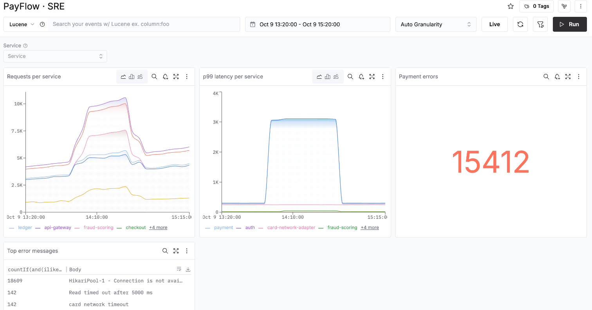
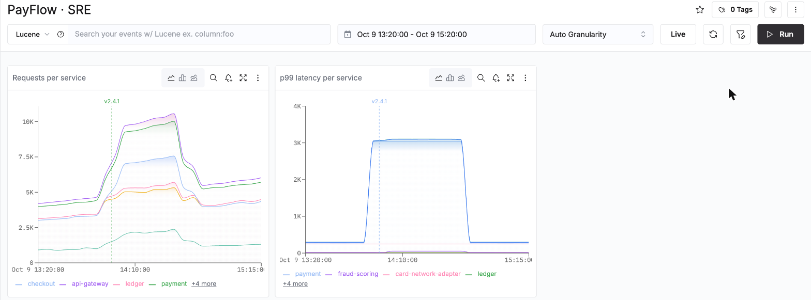

# Módulo 4 · Dashboards en ClickStack

Un dashboard responde a "¿funciona?" antes de que nadie lo pregunte. `01_agregados_red.sql` construye las cifras que hay detrás (RED por minuto, el histograma spanmetrics); este README construye el dashboard en sí en ClickStack, clic a clic.

Duración: 35 min. Ejecuta antes `01_agregados_red.sql` (checkpoint `OK`).

> Rango para todo el módulo: **el incidente**, fijado con el rango de tiempo, **Around a time**, Time `YYYY-MM-DD 14:20:00` (tu fecha de Black Friday, módulo 3 paso 0), Duration ± `1h`. Algunos pasos usan `Last 1 hour` (el flujo en directo) o `Last 30 days` (todo el mes): se indica cada vez.

---

## Paso 1 · Chart Explorer: una pregunta, un gráfico (8 min)

**Chart Explorer** (menú de la izquierda) es un `GROUP BY` con un formulario. La pantalla, de arriba abajo:

| Zona | Para qué sirve |
|---|---|
| **AI Assistant** (arriba, experimental) | describes un gráfico en una frase, ClickStack rellena el formulario |
| **Chart Name**, **Builder** / **SQL** | un nombre; el formulario o SQL directo |
| los tipos de gráfico | Time Series, Table, Number, Bar, Pie, Search, Heatmap, Patterns, Markdown |
| **Data Source** | PayFlow logs, traces o metrics |
| la línea de la serie | la agregación (Count of Events, Sum, 99th Percentile, Average, Maximum...), la columna o la métrica, **Where**, **Group By** |
| **Add Series**, **Add Formula**, **Add alert** | más líneas en el mismo gráfico, una fórmula entre series (A / B), una alerta sobre el gráfico |
| el rango de tiempo, la granularidad, **Run** | cuándo, por cuánto tiempo, ejecutar |
| **Generated SQL** (abajo) | la consulta que ejecuta ClickStack: ábrela una vez |

Construye cada gráfico de abajo. Con una fuente de métricas aparece un campo de métrica junto a la agregación: escribe las primeras letras y elige el nombre con su tipo, por ejemplo `hikaricp.connections.pending (Gauge)`. Para un percentil sobre trazas aparece un campo **SQL Column**: escribe `Duration / 1e6` (de nanosegundos a milisegundos).

| Data Source | Agregación | Columna o métrica | Where | Group By | Qué ves |
|---|---|---|---|---|---|
| PayFlow traces | 99th Percentile | `Duration / 1e6` | `SpanKind:Server` | `ServiceName` | tres servicios saltan a 3 s a las 13:58 |
| PayFlow traces | Count of Events | | `StatusCode:Error` | `ResourceAttributes['service.version']` | solo falla v2.4.1 |
| PayFlow metrics | Maximum | `hikaricp.connections.pending (Gauge)` | | `ResourceAttributes['service.version']` | decenas de hilos esperando en v2.4.1, ninguno en v2.4.0 |
| PayFlow metrics | 99th Percentile | `traces.span.metrics.duration (Histogram)` | `span.name:"POST /v1/payments"` | | el histograma spanmetrics de `01_agregados_red.sql` |
| PayFlow traces | Count of Events | | `SpanKind:Server ServiceName:api-gateway` | | rango `Last 30 days`: cuatro semanas, los fines de semana más bajos, el pico de Black Friday |

**Text-to-chart**: abre **AI Assistant** arriba, escribe *error count per service over the last hour* y envía. ClickStack rellena el formulario por ti; revisa el Where y el Group By que ha elegido antes de fiarte. Si el asistente no aparece, Generative AI está desactivado en tu equipo (Team Settings, **API & Agents**, **Configure Generative AI**).

---

## Paso 2 · El dashboard SRE (15 min)

1. Menú de la izquierda, **Dashboards**. Arriba, los **Preset Dashboards** (paso 4); debajo, tus dashboards.
2. **New Dashboard** (arriba a la derecha) y luego **Saved Dashboard** (se guarda para el equipo). Las otras opciones: **Temporary Dashboard** (solo en tu navegador) y **Generate with AI** (un dashboard esbozado a partir de tus datos, pruébalo al final).
3. El dashboard se abre como *My Dashboard*. Haz clic en el lápiz junto al nombre, escribe `PayFlow · SRE` y pulsa Intro.
4. **Add** y luego **New Tile**. El editor de tiles es Chart Explorer en una ventana: rellénalo, **Run** para previsualizar, **Save**. Crea estos tiles:

| Nombre del tile | Tipo de gráfico | Data Source | Ajustes |
|---|---|---|---|
| Requests per service | Time Series | PayFlow traces | Count of Events, Where `SpanKind:Server`, Group By `ServiceName` |
| p99 latency per service | Time Series | PayFlow traces | 99th Percentile de `Duration / 1e6`, Where `SpanKind:Server`, Group By `ServiceName` |
| Payment errors | Number | PayFlow traces | Count of Events, Where `StatusCode:Error SpanName:"POST /v1/payments"`; **Display Settings**, **Conditional colors**, **Add rule**: `>` `100`, el punto rojo bajo *Semantic*, **Apply** |
| Errors by version | Pie | PayFlow logs | Count of Events, Where `SeverityText:ERROR`, Group By `ResourceAttributes['service.version']` |
| Latency heatmap | Heatmap | PayFlow traces | `Duration`, Where `ServiceName:payment` |
| Top error messages | Table | PayFlow logs | Count of Events, Where `SeverityText:ERROR -ServiceName:api-gateway`, Group By `Body` (se excluyen las líneas de acceso de la pasarela: cada una es única, no se agruparían) |

> **Atención**: en el editor de tiles, **Escape** propone descartar el tile. Cierra un desplegable haciendo clic al lado. Escribe en un campo solo después de hacer clic dentro, o el texto acaba en el campo siguiente (comprueba **ORDER BY**, aquí debe quedar vacío).

En el rango del incidente el dashboard se ve así: el p99 de payment a 3 s de 13:58 a 14:44, el recuento de errores en rojo, el timeout de HikariPool arriba de la tabla.



Después:
- **Ordenar**: arrastra un tile por su título, cambia su tamaño desde la esquina inferior derecha. Cada tile tiene su propia barra de herramientas: tipo de gráfico, una lupa (abre los eventos correspondientes en Search), una campana (alerta sobre el tile), pantalla completa y **⋮** (editar, duplicar, borrar).
- **Filtros**: el icono de filtro a la izquierda de **Run** abre **Filters and Variables**. **Add new filter**: Display name `Service`, Data source **PayFlow traces**, Filter expression `ServiceName` (elígelo en las sugerencias), deja marcado **Broadcast filter condition** (el valor se aplica a todos los tiles, sea cual sea su fuente), **Save filter**, **Close**. Aparece un desplegable **Service** encima de los tiles: elige `payment`, todos los tiles lo siguen. Las otras opciones: **Single select**, **Required** (los tiles esperan un valor), **Available as variable** (una `$variable` para los tiles SQL del paso 3). Añade un segundo filtro sobre `ResourceAttributes['service.team']` de la misma forma.
- **Release markers**: menú del dashboard **⋮** (arriba a la derecha), **Show release markers**. Aparece una línea discontinua con la etiqueta `v2.4.1` a las 13:58 en los gráficos temporales: ClickStack lee `service.version` de la telemetría, no hay nada que configurar. La primera pregunta de cualquier incidente, respondida en el gráfico.

  
- **Row-click drilldown**: haz clic en la fila *HikariPool-1* de *Top error messages*. Search se abre sobre PayFlow logs, en el mismo rango, con el Where del tile y un filtro `Body IN ('HikariPool-1 ...')`: las líneas que hay detrás de la cifra. Es el comportamiento por defecto. Para cambiarlo, **⋮**, edita el tile, **Row Click Action: Default**: **Search** (otra fuente, un Where escrito con `{{ColumnName}}` a partir de la fila pulsada), **Dashboard** (otro dashboard con filtros, como `ServiceName = '{{ServiceName}}'`), **External** (una URL, como un runbook). **Atrás** en el navegador vuelve al dashboard.
- **Live**: pon el rango a `Last 1 hour` y haz clic en **Live**: el dashboard se refresca solo con el flujo en directo.
- El menú **⋮** tiene también **Enter kiosk mode** (una pantalla de pared), **Show alert annotations** (módulo 5), **Export Dashboard** e **Import New Dashboard** (JSON, para compartir un dashboard entre servicios).

---

## Paso 3 · Un tile SQL sobre los agregados (8 min)

Algunas preguntas necesitan SQL: un join, un ratio, un agregado (rollup). **Add**, **New Tile** y luego **SQL** (arriba a la derecha del editor, junto a **Builder**): aparece el mensaje *Chart converted to SQL* y el editor viene relleno con el SQL del formulario Builder. **Connection** `Default`; vacía **Source** con su **x** (la consulta lee un agregado, no una fuente). Encima del editor, **SQL Chart Instructions** da las reglas y las macros:

| Macro | Se convierte en |
|---|---|
| `$__timeFilter(col)` | `col` dentro del rango de tiempo del dashboard |
| `$__timeInterval(col)` | `col` redondeada a la granularidad del gráfico |
| `$__fromTime`, `$__toTime` | los límites del rango, en milisegundos |
| `$__sourceTable`, `$__filters` | la tabla de la fuente elegida, los filtros del dashboard (con una Source) |

La primera columna DateTime es el eje de tiempo, cada columna numérica una serie, cada columna String un grupo. Haz clic dentro del editor, selecciona todo (Cmd+A o Ctrl+A), borra y pega:

```sql
SELECT
    $__timeInterval(minute)                                             AS ts,
    round(100 * sum(errors) / sum(requests), 2)                         AS error_pct,
    round(quantilesTDigestMerge(0.5, 0.95, 0.99)(latency)[3] / 1e6)     AS p99_ms
FROM payflow_sre.red_1m
WHERE service = 'api-gateway' AND operation = 'POST /v1/payments'
  AND $__timeFilter(minute)
GROUP BY ts
ORDER BY ts
```

Dos avisos naranjas piden `$__sourceTable` y `$__filters`: son consejos para los tiles sobre una fuente, aquí ignóralos. Ponle el nombre `POST /v1/payments, rollup`, **Run**, **Save**. El tile lee unos cientos de filas del agregado en vez de millones de spans: para eso sirve `01_agregados_red.sql`. Pon el rango a `Last 30 days`: sigue siendo instantáneo.

Un segundo tile SQL, tipo de gráfico **Table**, el presupuesto de errores de Black Friday (el tipo tabla no necesita macro de tiempo):

```sql
SELECT
    sum(requests)                                                   AS requests,
    sum(errors)                                                     AS errors,
    round(100 * (1 - sum(errors) / sum(requests)), 3)               AS availability_pct,
    round(100 * sum(errors) / (sum(requests) * 0.0005), 1)          AS budget_spent_pct
FROM payflow_sre.red_1m
WHERE service = 'api-gateway' AND operation = 'POST /v1/payments'
  AND toDate(minute) = pf_black_friday()
```

Una sola mala versión se ha comido varias veces el presupuesto de errores del día.

---

## Paso 4 · Dashboards predefinidos (4 min)

**Dashboards**, **Preset Dashboards**:
- **Services**: vistas HTTP, base de datos y errores de cada servicio, desde una fuente de trazas. Elige **PayFlow traces** arriba. En el rango del incidente, las llamadas a base de datos de payment destacan.
- **Kubernetes**: elige **PayFlow logs** y **PayFlow metrics** arriba. Pestañas **Pods**, **Nodes**, **Namespaces**: CPU, memoria, fase, reinicios y tiempo en marcha de cada pod, los nodos y su disponibilidad. Nuestras métricas siguen los nombres de los receptores kubeletstats y k8s_cluster, que es exactamente lo que lee este dashboard. En el rango del incidente, el pod fraud-scoring de ip-10-0-3-17 muestra su reinicio.
- **Browse dashboard templates**: métricas de runtime para servicios Go, JVM, Node.js y .NET, para importar.
