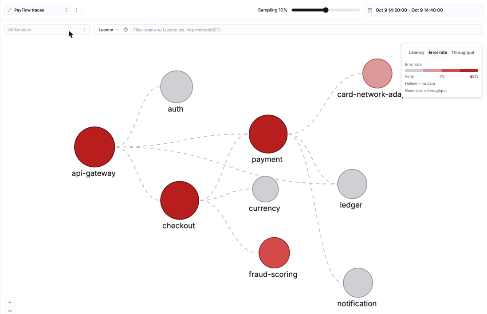
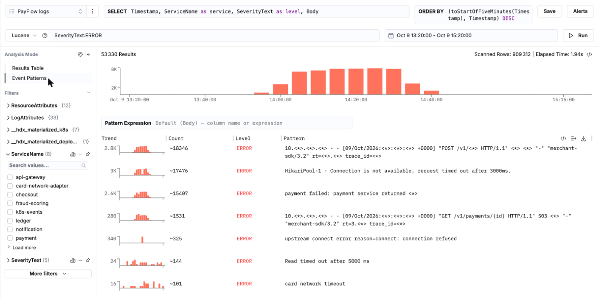
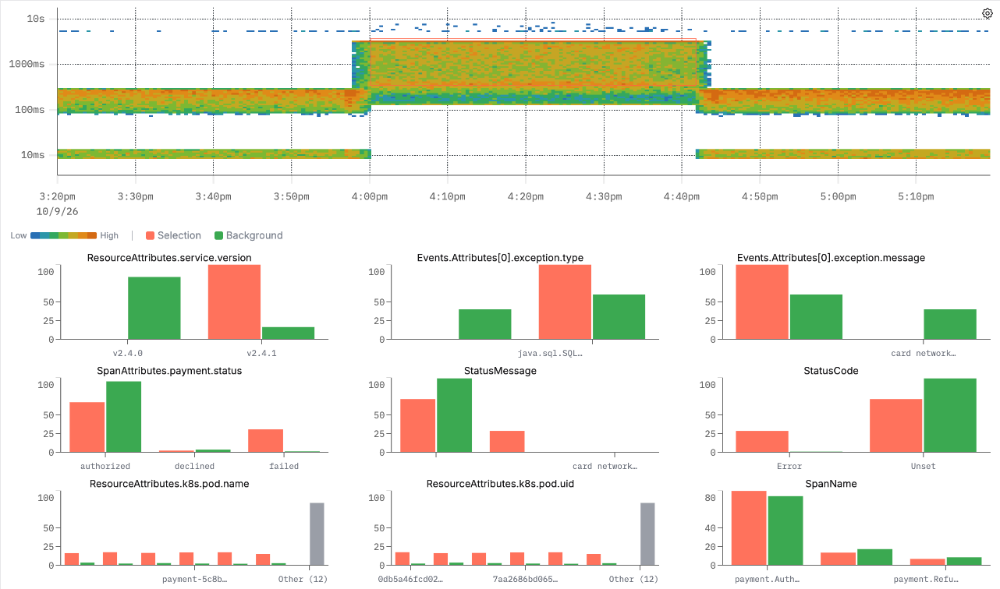

# Módulo 6 · La investigación: Black Friday, 14:00

El aviso (page) llegó a las 14:00: *POST /v1/payments: error budget burning 19x faster than allowed*. Tienes ClickStack y la consola SQL. Encuentra qué se ha roto, por qué, a quién afecta y cuánto ha costado.

Duración: 45 min.
- Parte 1 (25 min): el recorrido por ClickStack que sigue, una pantalla por pregunta.
- Parte 2 (20 min): `01_mapa_y_patrones.sql` y `02_incidente_en_sql.sql`, las mismas respuestas en SQL, con el impacto de negocio.

> Rango para todo el módulo: **el incidente**. En el rango de tiempo: **Around a time**, Time `YYYY-MM-DD 14:20:00` (tu fecha de Black Friday, `SELECT pf_black_friday()`, módulo 3 paso 0), Duration ± `1h`, **Apply**. Todas las horas están en UTC (módulo 3, paso 2).

---

## Paso 1 · ¿Cómo de grave, y dónde? El mapa de servicios (5 min)

1. Menú de la izquierda, **Service Map** (beta).
2. Arriba a la izquierda, la fuente: **PayFlow traces**. Arriba a la derecha, el rango de tiempo: **Around a time**, `14:30:00`, ± `15m` (el corazón del incidente).
3. Lee el mapa:
   - cada círculo es un servicio (`service.name`), cada línea discontinua una llamada: un span de cliente emparejado con el span de servidor al que llamó;
   - la leyenda (arriba a la derecha) tiene tres pestañas. **Error rate**: gris es sin errores, rojo oscuro es un 5 % o más. **Latency** y **Throughput** colorean según las otras dos señales. El tamaño de un círculo es siempre el tráfico.
4. En **Error rate**: `api-gateway`, `checkout` y `payment` están en rojo oscuro. `ledger` y `notification` están en gris: los pagos fallidos nunca llegaron hasta ellos. `fraud-scoring` también está en rojo: guárdalo para el paso 5.
5. Cambia la leyenda a **Latency** (el p95): los mismos tres servicios se oscurecen, unos 3 s, los demás siguen claros. **All Services** (arriba a la izquierda) reduce el mapa a un servicio y sus vecinos; el campo Lucene filtra los spans con los que se construye el mapa (prueba `SpanAttributes['merchant.id']:m_00042`).
6. **Sampling** (arriba): el mapa se construye a partir de una muestra de las trazas, el 10 % por defecto. Baja el control en un dataset grande: el mapa carga más rápido y sigue siendo correcto.

## Paso 2 · ¿Qué dicen los errores? Event Patterns (5 min)

1. **Search**, fuente **PayFlow logs**, búsqueda `SeverityText:ERROR`, rango **el incidente**, **Run**.
2. Columna de la izquierda, **Analysis Mode**: haz clic en **Event Patterns** (en lugar de **Results Table**).
3. Decenas de miles de líneas se reducen a un puñado de patrones. ClickStack sustituye las partes variables (ips, ids, números) por `<*>`. Para cada patrón: una **Trend** (un pequeño histograma sobre el rango), un **Count**, el **Level**.
4. Lee de arriba abajo: las líneas de acceso de la pasarela (`POST /v1/<*> ... 503`), luego el **timeout de HikariPool-1** en payment, luego el "payment failed: payment service returned <*>" de checkout. La pasarela y checkout solo transmiten lo que dice payment: la línea de HikariPool es la que hay que seguir.
5. Acota: haz clic en `payment` bajo **ServiceName** en los filtros. Queda un solo patrón, el timeout del pool.
6. **Pattern Expression** (encima de la tabla) cambia lo que se agrupa: `Body` por defecto; escribe `ServiceName` para contar por servicio.

## Paso 3 · ¿Qué tienen en común los spans lentos? Event Deltas (5 min)

1. **Search**, fuente **PayFlow traces**, búsqueda `ServiceName:payment`, rango **el incidente**, **Run**.
2. **Analysis Mode**, **Event Deltas** (solo trazas).
3. El mapa de calor: el tiempo en horizontal, la duración en vertical (escala logarítmica), el color para el número de spans. Antes de las 13:58 los spans se sitúan en dos bandas, unos pocos ms (llamadas a la base de datos) y de 100 a 300 ms (las llamadas de pago). De 13:58 a 14:42 un bloque sube a entre 1 y 3 s, con un techo plano en 3 000 ms: un timeout fijo deja exactamente esta firma. Mientras no selecciones nada, los gráficos de abajo dicen *Select an area on the chart above to enable comparisons*. (El eje de este gráfico está en la hora local de tu navegador, no en UTC.)
4. **Dibuja un rectángulo** alrededor del bloque lento. Debajo, un gráfico por atributo compara la selección (**Selection**, naranja) con todo lo demás (**Background**, verde), primero los atributos que más difieren. Pasa el ratón por una barra para ver sus porcentajes exactos.
5. Busca `ResourceAttributes.service.version` entre los primeros gráficos: la selección es 100 % **v2.4.1**, el fondo sobre todo v2.4.0 (59 %). Alrededor: `k8s.pod.name` solo muestra los seis pods `payment-5c8b...`, `payment.status` `failed`, `StatusCode` `Error`.
6. Haz clic en la barra **v2.4.1**: se abre una pequeña ventana con tres iconos, **Filter for this value**, **Exclude this value** y copiar. **Filter for this value**: la búsqueda y el mapa de calor se redibujan solo con la versión defectuosa. **Exclude this value** muestra el resto: los pods v2.4.0, antes de las 13:58 y después de las 14:42, sin el bloque lento.

## Paso 4 · ¿Qué ha cambiado? Release markers y los logs de arranque (5 min)

1. **Dashboards**, **PayFlow · SRE** (módulo 4), rango **el incidente**, menú **⋮** (arriba a la derecha), **Show release markers**: una línea discontinua `v2.4.1` a las 13:58, justo donde salta el p99.
2. **Search**, fuente **PayFlow logs**, búsqueda `"maximumPoolSize"`, rango **el incidente**. Seis líneas desde las 13:58 (los seis pods v2.4.1 arrancando, uno cada 30 s) dicen `maximumPoolSize=10`; abre una, su etiqueta **version** dice `v2.4.1`. Seis líneas desde las 14:42, el rollback a v2.4.0, dicen 50. Rango `Last 30 days`: los pods v2.4.0 de la versión de diez días antes también decían 50.
3. El cambio: en la consola SQL, `SELECT * FROM payflow_inventory.deployment_history WHERE deployment = 'payment' ORDER BY valid_from`. CHG-4117, j.martin, 13:58: "pool size 50 to 10".
4. El lado de los recursos: abre una traza fallida (módulo 3, paso 5), pestaña **Infrastructure**. CPU baja, memoria plana: el pod no está ocupado, espera conexiones.
5. La prueba en las métricas: **Chart Explorer**, **PayFlow metrics**, **Maximum** de `hikaricp.connections.pending (Gauge)`, **Group By** `ResourceAttributes['service.version']`, **Run**: v2.4.1 encola decenas de hilos, v2.4.0 ninguno.

## Paso 5 · El segundo fuego (3 min)

1. **Search**, fuente **PayFlow logs**, búsqueda `ServiceName:k8s-events SeverityText:WARN -EventName:Unhealthy`, rango **el incidente**. Cuatro eventos, lee la columna **EventName**: `NodeHasInsufficientMemory` en el nodo `ip-10-0-3-17` a las 14:19:31, `OOMKilling` del worker de fraud-scoring a las 14:21:07, `BackOff` (el contenedor reinicia, `OOMKilled, exit code 137`), y `NodeHasSufficientMemory` a las 14:23:40.
2. **Chart Explorer**, **PayFlow metrics**, **Maximum** de `k8s.pod.memory.usage (Gauge)`, **Where** `ResourceAttributes['k8s.node.name']:ip-10-0-3-17`, **Group By** `ResourceAttributes['k8s.pod.name']`, **Run**: el pod de fraud-scoring sube con los reintentos de los clientes (su tráfico x2,2) y luego cae al reiniciar.
3. Abre uno de los spans "connection refused" de las 14:21 (módulo 3, escenario C), pestaña **Infrastructure**: los gráficos del pod (CPU, memoria, disco) alrededor del error, y el **Pod Timeline**, los eventos de Kubernetes de ese pod.

Una consecuencia del incidente (los reintentos), no su causa. Las dos van al postmortem.

## Paso 6 · Pídeselo a una IA (2 min)

Menú de la izquierda, **AI notebooks** (beta), **New Private Notebook**. En **Ask AI to explore your data**, escribe, con tu fecha de Black Friday:

*¿Por qué falló POST /v1/payments entre las 13:58 y las 14:45 UTC del YYYY-MM-DD? Usa las fuentes PayFlow.*

Mira cómo añade bloques (búsquedas, gráficos) uno tras otro y compara su conclusión con la tuya. La función está en beta: si no aparece ningún bloque, añádelos a mano con **Manual Block** (Search, Chart, Table, Markdown) y conserva el notebook como registro escrito de tu investigación. El módulo 8 muestra las mismas preguntas hechas a través de MCP.

---

## Parte 2 · La misma investigación en SQL (20 min)

- `01_mapa_y_patrones.sql`: el mapa de servicios y los patrones de eventos, calculados por vistas materializadas refrescables, antes y durante el incidente.
- `02_incidente_en_sql.sql`: diez preguntas, del aviso a la causa raíz, la traza en forma de árbol (CTE recursiva), el cambio activo en cada error, el segundo fuego y **el impacto de negocio**: pagos fallidos, euros, comercios.

La última consulta construye la cronología del postmortem con todas las señales a la vez.
