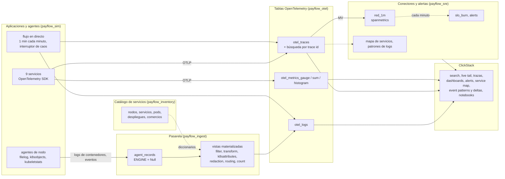

# ClickHouse de cero a avanzado · Taller de observabilidad

Black Friday en **PayFlow**, una plataforma de pagos que corre sobre Kubernetes. A las 13:58 una nueva versión reduce el pool de conexiones a la base de datos de 50 a 10. Los pagos empiezan a fallar, los reintentos se acumulan, un pod muere por falta de memoria. Recoges todas las señales de ese día en **tu propio servicio ClickHouse Cloud**, las exploras en **ClickStack** (búsqueda, dashboards, alertas, mapa de servicios, event patterns, AI notebooks) y ves por debajo, en SQL, cómo funciona cada funcionalidad.

Logs, trazas, métricas y eventos de Kubernetes están **simulados en SQL**: sin colector, sin generador de carga, nada que instalar. Siguen exactamente el esquema OpenTelemetry del exportador de ClickHouse, así que ClickStack los lee como si los hubiera escrito un colector real. Todo es determinista: todo el mundo obtiene las mismas cifras. Un flujo en directo reproduce tráfico cada minuto, y un interruptor te permite romper producción a propósito.

---

## La arquitectura: el recorrido de la telemetría

El taller sigue el recorrido de la telemetría real, con el vocabulario del colector OpenTelemetry y de ClickStack. Lo que un colector haría en el borde, aquí lo hace la pasarela (gateway) dentro de ClickHouse, con vistas materializadas: el enfoque que recomienda la documentación de ClickHouse para el procesamiento pesado.



| Base de datos | Papel | Tablas |
|---|---|---|
| `payflow_sim` | las aplicaciones y sus agentes, simulados en SQL; el flujo en directo | vistas, el interruptor de caos |
| `payflow_ingest` | la tabla de aterrizaje de la pasarela del colector (no almacena nada) | `agent_records` |
| `payflow_otel` | lo que escribe el exportador de ClickHouse: las fuentes de ClickStack | `otel_logs`, `otel_traces`, `otel_metrics_*`, búsqueda por traza, agregados (rollups) |
| `payflow_sre` | lo que calculan los conectores y las alertas | `red_1m`, `slo_burn`, `alerts`, `service_map_5m`, `log_patterns_10m`, `log_volume_1m` |
| `payflow_inventory` | el catálogo de servicios, cargado en memoria como diccionarios | `node`, `service`, `pod`, `deployment_history`, `merchant` |

---

## Antes de la sesión (20 min, el día anterior)

1. **Crea tu cuenta de ClickHouse Cloud** en [clickhouse.cloud](https://clickhouse.cloud). Recibes 300 $ de créditos, mucho más de lo que necesita la jornada.
2. **Crea un servicio** con esta configuración:

   | Parámetro | Valor | Por qué |
   |---|---|---|
   | Región | AWS **eu-central-1** (o la más cercana a ti) | |
   | Réplicas | **3** | los grandes escaneos se reparten entre las 3 (módulo 7) |
   | Memoria por réplica | **64 GB** (16 vCPU), **mínimo = máximo** | tamaño fijo: sin esperar al autoescalado durante una demo |
   | Reposo (idling) | **tras 1 hora** de inactividad, como mínimo | el servicio no se duerme durante una pausa |

   Coste orientativo: unos 11 $ por hora como máximo con este tamaño, menos de 70 $ la jornada. La calculadora de [clickhouse.com/pricing](https://clickhouse.com/pricing) da la tarifa exacta.
3. **Abre la consola SQL** del servicio y ejecuta `SELECT version()`. Después abre una vez **ClickStack** desde el menú de la izquierda, para comprobar que está disponible en tu servicio.
4. Opcional, para ponerte al día desde la línea de comandos: instala el cliente nativo (`curl https://clickhouse.com/ | sh`).

Cada archivo SQL se ejecuta en la consola SQL, instrucción por instrucción o todo de una vez. Ninguna instrucción pasa de 60 segundos. Cada archivo termina con un checkpoint que debe mostrar `OK` en todas partes. Cada módulo con una parte en ClickStack tiene un README con los pasos en la interfaz.

---

## Programa (5 horas)

| Hora | Módulo | ClickStack | El SQL por debajo | Duración |
|---|---|---|---|---|
| 0:00 | **00** Primeros pasos | | un millón de líneas de log generadas, parseadas y agregadas en una consulta | 10 min |
| 0:10 | **01** Modelo de datos | | el catálogo de servicios y sus diccionarios; las tablas OpenTelemetry, tal como las crea el exportador | 25 min |
| 0:35 | **02** Recolección | | las aplicaciones y los agentes, la pasarela (tabla Null y procesadores como vistas: parseo, enriquecimiento, enmascarado de tarjetas, filtro, conteo), trazas y métricas OTLP, el flujo en directo | 40 min |
| 1:15 | **03** Búsqueda y correlación | sources, búsqueda Lucene y SQL, saved search, live tail, del log a la traza y al pod; tres investigaciones, desde un log, una alerta de métrica, una traza | los índices de texto, EXPLAIN, los tres escenarios en SQL | 45 min |
| 2:00 | pausa | | | 10 min |
| 2:10 | **04** Dashboards | Chart Explorer, un dashboard con filtros, release markers, drilldown al hacer clic en una fila, tiles SQL, presets, text-to-chart | agregados RED (spanmetrics), el histograma de latencia con exemplars | 35 min |
| 2:45 | **05** SLO y alertas | alertas de búsqueda, de gráfico y SQL, un webhook; **rompe producción y recibe el aviso** | presupuesto de errores, tasa de consumo (burn rate), alertas multiventana | 30 min |
| 3:15 | **06** Investigación | service map, event patterns, event deltas, release markers, Infrastructure tab | las 10 preguntas, la traza como árbol, el coste del incidente | 40 min |
| 3:55 | pausa | | | 10 min |
| 4:05 | **07** Escala y coste | un agregado (rollup) registrado en la source | 875 M de líneas de log: índice de texto, bloom filter, proyección, cachés, 3 réplicas; retención, muestreo, dimensionamiento | 35 min |
| 4:40 | **08** IA y gobernanza | AI notebooks, MCP, RBAC | ClickHouse Agents, row policies, borrado RGPD, una API de estado | 20 min |

---

## Ponerse al día

¿Te has quedado atrás o ha fallado un módulo? El script `run_all.sh` vuelve a ejecutar los archivos SQL con el cliente nativo, desde tu máquina, en la carpeta `es/`:

```bash
cd es
export CH_HOST=<tu-servicio>.<region>.clickhouse.cloud
export CH_PASSWORD='<contraseña>'
```

```bash
./run_all.sh 01 04
```
Vuelve a ejecutar los módulos 01 a 04, sin reset.

```bash
./run_all.sh 05_slo
```
Retoma desde un módulo hasta el final.

```bash
./run_all.sh
```
Todo desde cero, reset incluido: unos 10 minutos.

Al final de la jornada, ejecuta `detener_flujo_en_directo.sql`: el flujo en directo se refresca cada minuto y mantiene el servicio despierto. `reset.sql` borra solo lo que ha creado el taller: las bases de datos `payflow_*`, el usuario y los roles, y las funciones `pf_*`.

---

## Glosario

| Término | Significado | Término | Significado |
|---|---|---|---|
| **Señal** | un tipo de telemetría: logs, trazas, métricas (y sesiones en ClickStack) | **Wide event** | un registro rico con muchos atributos (eventos enriquecidos), alta cardinalidad permitida |
| **Resource / atributos** | quién lo emitió (servicio, pod, nodo) / los detalles del evento | **Span / traza** | una operación de una petición / el árbol de spans de una petición |
| **Colector** | el agente o la pasarela OpenTelemetry: receptores, procesadores, exportadores, conectores | **Agente / pasarela** | un colector en cada nodo / un colector central que procesa y exporta |
| **Procesador** | una etapa del colector: filter, transform, k8sattributes, redaction, batch | **Conector** | convierte una señal en otra: spanmetrics (RED), servicegraph, count |
| **ClickStack** | el stack de observabilidad de ClickHouse: ClickHouse, el colector, la interfaz HyperDX | **Source** | en ClickStack, una tabla declarada como logs, trazas o métricas |
| **RED** | Rate, Errors, Duration: las tres cifras de un servicio | **SLO / presupuesto de errores** | el 99,95 % de los pagos tiene éxito / el 0,05 % de errores permitido |
| **Burn rate** | la velocidad a la que se gasta el presupuesto; 14,4 = el presupuesto de un mes en 2 días | **Exemplar** | el trace id guardado con un punto de métrica, para saltar de un gráfico a una traza |
| **Event patterns / deltas** | líneas de log agrupadas en mensajes / lo que distingue a los spans lentos | **Release marker** | la línea de un gráfico donde aparece por primera vez una nueva versión |
| **HikariCP** | el pool de conexiones a base de datos de Java; su tamaño es aquí la causa raíz | **OOMKilled** | matado por el kernel por usar más memoria de la permitida |
| **PAN** | el número de tarjeta, que nunca debe almacenarse en claro (PCI DSS) | **Motor Null** | una tabla que no almacena nada; sus vistas materializadas ven cada inserción |
| **MV / RMV** | vista materializada incremental / vista materializada refrescable | **Índice de texto / bloom filter** | un índice de las palabras de una columna / "seguro que no está en este gránulo" |

---

## Contenido del repositorio

```
00_primeros_pasos/            un millón de líneas de log en una consulta
01_modelo_de_datos/           el catálogo de servicios y sus diccionarios, las tablas OpenTelemetry
02_recoleccion/               simulador, pipeline de la pasarela, trazas y métricas OTLP, flujo en directo
03_busqueda_y_correlacion/    búsqueda en ClickStack, tres escenarios de correlación (README) y el SQL por debajo
04_dashboards/                dashboards de ClickStack (README) y los agregados RED
05_slo_y_alertas/             alertas de ClickStack y el interruptor de caos (README), burn rate del SLO en SQL
06_investigacion/             el incidente en ClickStack (README), mapa de servicios, patrones, 10 preguntas
07_escala_y_coste/            mil millones de líneas de log, índices y cachés, agregados, retención, muestreo
08_ia_y_gobernanza/           AI notebooks, MCP, ClickHouse Agents, RBAC, API de estado (README); permisos y RGPD
run_all.sh, reset.sql         ejecución completa y limpieza
detener_flujo_en_directo.sql  detener el flujo en directo al final de la jornada
RESULTADOS.md                 cifras medidas en el servicio de prueba, módulo a módulo
```

## Buenas prácticas ilustradas

| Regla | Dónde |
|---|---|
| Usar el esquema del exportador: ClickStack lo lee tal cual | módulo 1 |
| Procesamiento pesado en la base de datos: tabla Null y vistas materializadas | módulo 2 |
| Diccionarios para el enriquecimiento (`query-join-use-dictionaries`) | módulos 1, 2, 6 |
| Vistas materializadas incrementales para los agregados (`mv-incremental`); vistas refrescables para ventanas y joins | módulos 4, 5, 6 |
| Agregados registrados en la source, columnas de agregación con el nombre `<function>__<column>` | módulo 7 |
| Índices de texto, bloom filters y proyecciones declarados en el CREATE | módulos 1, 7 |
| Retención por particiones completas (`ttl_only_drop_parts`), muestreo que conserva las trazas adecuadas | módulo 7 |
| Comentarios en tablas y columnas para los agentes (`agent-discovery-schema`) | módulo 8 |
