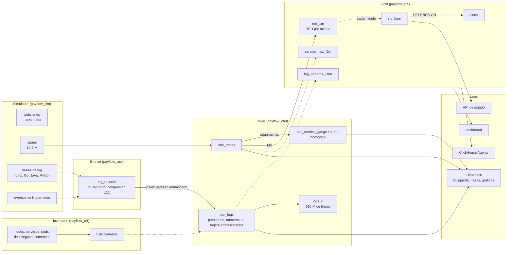

# ClickHouse de cero a avanzado · Workshop de observabilidad

Black Friday en **PayFlow**, una plataforma de pagos que corre sobre Kubernetes. A las 13:58 una release reduce el pool de conexiones a la base de datos de 50 a 10. Los pagos empiezan a fallar, los reintentos se acumulan y un pod muere por falta de memoria. Vas a recoger, modelar y consultar todas las señales de ese día en **tu propio servicio ClickHouse Cloud**, y después llevar la investigación en SQL y en ClickStack, la interfaz de observabilidad de ClickHouse.

Logs, trazas, métricas y eventos de Kubernetes están **simulados en SQL** (sin collector, sin generador de carga, nada que instalar) y son deterministas: todo el mundo obtiene las mismas cifras. Siguen exactamente el esquema OpenTelemetry, así que ClickStack los lee como si los hubiera escrito un collector real.

```
 logs de contenedor ──► bronze ──MV──► silver (OpenTelemetry) ──MV / vistas refrescables──► gold ──► ClickStack
 eventos k8s           JSON bruto     otel_logs, otel_traces,      RED, burn rate del SLO,          dashboards
 trazas, métricas      (intacto)      otel_metrics_*               alertas, mapa de servicios       API, agente IA
```

---

## La arquitectura del workshop

Cada flecha es SQL que se ejecuta dentro de ClickHouse. Flecha continua: vista materializada incremental, disparada por cada INSERT. Flecha punteada: vista materializada refrescable, recalculada según una programación.



| Capa | Tablas | Qué muestra |
|---|---|---|
| **Inventario** | `payflow_ref.*`: 12 nodos, 9 servicios, 49 pods, el historial de despliegues, 20 000 comercios | el contexto con el que se cruza cada señal |
| **Bronze** | `payflow_raw.log_records` | las líneas de log brutas de los contenedores y los eventos de Kubernetes, intactos, tal como los envían los agentes |
| **Silver** | `otel_logs`, `otel_traces`, `otel_metrics_gauge`, `otel_metrics_sum`, `otel_metrics_histogram` | el esquema del exporter OpenTelemetry; logs parseados desde 4 formatos, números de tarjeta enmascarados |
| **Gold** | `red_1m`, `slo_burn`, `alerts`, `service_map_5m`, `log_patterns_10m` | lo que vigila un SRE, unos pocos MB para todo el día |
| **Usos** | ClickStack, dashboard de la consola SQL, Query API endpoint, ClickHouse Agents | todo lee ClickHouse directamente |

---

## Antes de la sesión (20 min, la víspera)

1. **Crea tu cuenta de ClickHouse Cloud** en [clickhouse.cloud](https://clickhouse.cloud). Recibes 300 $ de créditos, mucho más de lo que necesita el día.
2. **Crea un servicio** con esta configuración:

   | Parámetro | Valor | Por qué |
   |---|---|---|
   | Región | AWS **eu-central-1** (o la más cercana a ti) | |
   | Réplicas | **3** | los scans grandes se reparten entre las 3 (módulo 6) |
   | Memoria por réplica | **64 GB** (16 vCPU), **mínimo = máximo** | tamaño fijo: no hay que esperar al autoscaling en mitad de una demo |
   | Idling (reposo) | **tras 1 hora** de inactividad como mínimo | el servicio no se duerme durante una pausa |

   Coste orientativo: unos 11 $ por hora como máximo con este tamaño, menos de 70 $ el día. La calculadora de [clickhouse.com/pricing](https://clickhouse.com/pricing) da la tarifa exacta.
3. **Abre la consola SQL** del servicio y ejecuta `SELECT version()`.
4. Opcional, para ponerte al día desde la línea de comandos: instala el cliente nativo (`curl https://clickhouse.com/ | sh`).

Cada fichero SQL se ejecuta en la consola SQL, instrucción a instrucción o todo de una vez. Ninguna instrucción pasa de 60 segundos. Cada fichero termina con un checkpoint que debe mostrar `OK` en todas partes.

---

## Programa (5 horas)

| Hora | Módulo | Contenido | Duración |
|---|---|---|---|
| 0:00 | **00** Primeros pasos | un millón de líneas de log generadas, parseadas y agregadas en una sola consulta | 10 min |
| 0:10 | **01** Fundamentos | MergeTree, ORDER BY, LowCardinality; el inventario: nodos, servicios, pods, despliegues, comercios | 25 min |
| 0:35 | **02** Bronze | el simulador SQL, 6 millones de líneas de log brutas en 25 s, exploración del JSON, un problema PCI | 35 min |
| 1:10 | **03** Silver | las tablas OpenTelemetry, el pipeline de logs (4 formatos, severidad, trace ids, enmascarado de tarjetas), trazas, métricas | 40 min |
| 1:50 | pausa | | 10 min |
| 2:00 | **04** Diccionarios | equipo, nodo, comercio, y "qué cambio estaba activo en ese momento" | 20 min |
| 2:20 | **05** Gold | métricas RED, tasa de consumo (burn rate) del SLO, alertas, mapa de servicios a partir de las trazas, patrones de logs | 35 min |
| 2:55 | **06** Rendimiento | 910 M de líneas de log: índice de texto, bloom filter, proyección, cachés de consultas, 3 réplicas | 30 min |
| 3:25 | pausa | | 10 min |
| 3:35 | **07** Investigación | del aviso (page) a la causa raíz en 10 consultas, el coste del incidente, reproceso, RGPD, seguridad | 40 min |
| 4:15 | **08** ClickStack y agentes | la misma investigación en ClickStack, un dashboard, una API de estado, ClickHouse Agents | 45 min |

---

## Ponerse al día

¿Te has quedado atrás o ha fallado un módulo? El script `run_all.sh` vuelve a ejecutar los ficheros con el cliente nativo, desde tu máquina, en la carpeta `es/`:

```bash
cd es
export CH_HOST=<tu-servicio>.<region>.clickhouse.cloud
export CH_PASSWORD='<contraseña>'
```

```bash
./run_all.sh 01 04
```
Vuelve a ejecutar los módulos 01 a 04, sin reset.

```bash
./run_all.sh 05_gold
```
Reanuda desde un módulo hasta el final.

```bash
./run_all.sh
```
Todo desde cero, reset incluido: unos 10 minutos.

`reset.sql` solo elimina lo que ha creado el workshop: las bases `payflow_*`, el usuario y los roles, y las funciones `pf_*`.

---

## Glosario

| Término | Significado | Término | Significado |
|---|---|---|---|
| **Log** | una línea con marca de tiempo escrita por un programa | **Span** | una operación de una petición (una llamada HTTP, una consulta), con un inicio y una duración |
| **Traza** | el árbol de spans de una petición, a través de los servicios | **TraceId / SpanId** | los identificadores que enlazan logs y spans |
| **Métrica** | un número medido a lo largo del tiempo: gauge (un valor), sum (un contador), histogram (una distribución) | **OpenTelemetry (OTel)** | el estándar abierto para logs, trazas y métricas |
| **RED** | Rate, Errors, Duration: las tres cifras de un servicio | **SLO** | objetivo de nivel de servicio, p. ej. el 99,95 % de los pagos tienen éxito |
| **Presupuesto de errores** | los errores que permite el SLO (aquí el 0,05 %) | **Tasa de consumo (burn rate)** | lo rápido que se gasta el presupuesto; 14,4 = el presupuesto de un mes en 2 días |
| **Exemplar** | el trace id que se guarda con un punto de métrica, para saltar de un gráfico a una traza | **Mapa de servicios** | quién llama a quién, reconstruido a partir de los spans padre e hijo |
| **ClickStack** | el stack de observabilidad de ClickHouse: ClickHouse, collector OpenTelemetry, interfaz HyperDX | **HyperDX** | la interfaz de ClickStack: búsqueda, trazas, dashboards, alertas |
| **Pod / nodo** | un grupo de contenedores en ejecución / la máquina que lo aloja | **Rollout / rollback** | despliegue progresivo: sustituir los pods por una nueva versión / marcha atrás: volver a la anterior |
| **OOMKilled** | matado por el kernel por usar más memoria de la permitida | **HikariCP** | el pool de conexiones Java a la base de datos; su tamaño es aquí la causa raíz |
| **PAN** | primary account number: el número de tarjeta, que nunca debe aparecer en claro en un log (PCI DSS) | **MV / RMV** | vista materializada incremental / vista materializada refrescable |
| **Índice de texto** | un índice de las palabras de una columna, para la búsqueda de texto completo | **Bloom filter** | un índice compacto que dice "seguro que no está en este gránulo" |
| **Proyección** | una segunda copia de una tabla, preordenada o preagregada, que se elige automáticamente | **Gránulo** | la unidad que lee ClickHouse: 8 192 filas |

---

## Contenido del repositorio

```
00_introduccion/                 primeros pasos
01_fundamentos/                  bases de datos, MergeTree, el inventario de la plataforma
02_bronze/                       el simulador SQL, ingesta bruta, exploración del JSON
03_silver/                       tablas OpenTelemetry, pipeline de logs, trazas y métricas
04_diccionarios/                 enriquecimiento en memoria, "qué cambio estaba activo"
05_gold/                         RED, SLO y alertas, mapa de servicios y patrones de logs
06_rendimiento/                  mil millones de líneas de log, índices, proyecciones, réplicas
07_investigacion/                el incidente, paso a paso; operación
08_clickstack_dashboards_agente/ README paso a paso: ClickStack, dashboard, API, agente (sin fichero SQL)
run_all.sh, reset.sql            ejecución completa y limpieza
RESULTADOS.md                    cifras medidas en el servicio de prueba, módulo a módulo
```

## Buenas prácticas de ClickHouse ilustradas

| Regla | Dónde |
|---|---|
| Elegir el ORDER BY a partir de los filtros más frecuentes (`schema-pk-plan-before-creation`) | módulos 1, 3 |
| LowCardinality para las cadenas repetidas, sin Nullable | módulos 1, 3 |
| Vistas materializadas incrementales para la ingesta y los agregados (`mv-incremental`) | módulos 3, 5 |
| Vistas materializadas refrescables para ventanas y joins, `DEPENDS ON`, `SYSTEM WAIT VIEW` | módulo 5 |
| Diccionarios en lugar de joins para enriquecer (`query-join-use-dictionaries`) | módulo 4 |
| Índices de salto (texto, bloom filter) y proyecciones declarados en el CREATE | módulo 6 |
| DELETE ligero y operaciones de partición en lugar de mutaciones | módulo 7 |
| Comentarios en tablas y columnas para los agentes (`agent-discovery-schema`) | módulo 8 |
