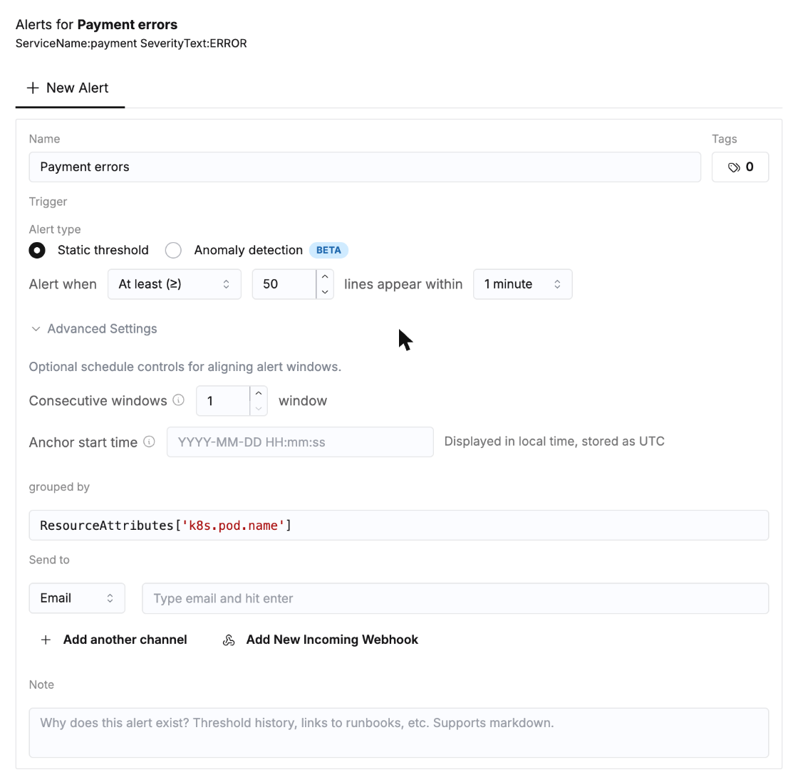
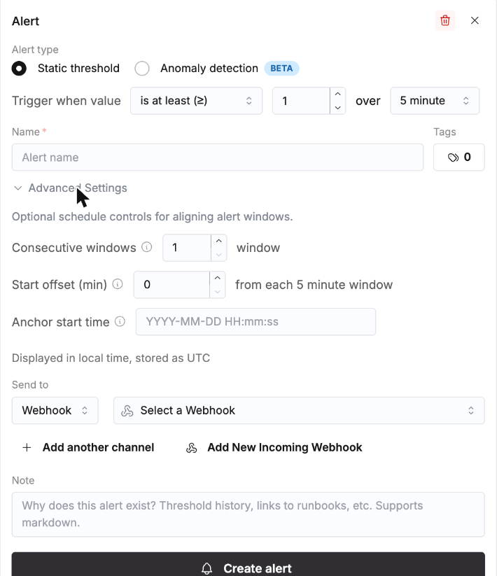
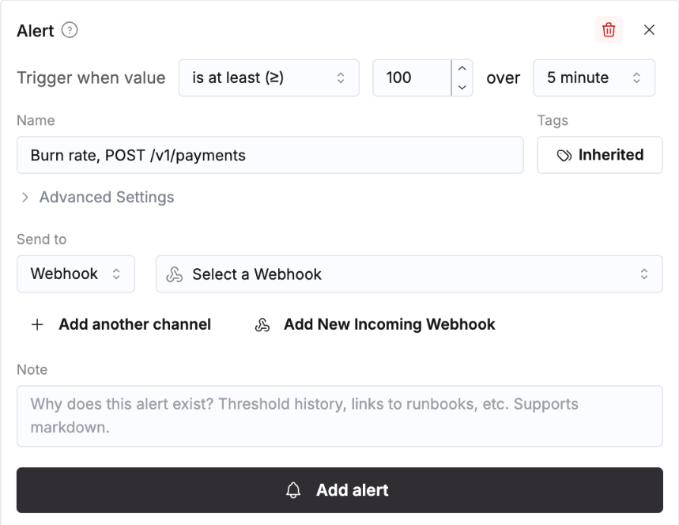

# Module 5 · SLO et alertes : casser la production, se faire réveiller

Une alerte, c'est une requête lancée à intervalle régulier et comparée à un seuil. `01_burn_rate_slo.sql` construit en SQL la méthode SRE (budget d'erreur, taux de consommation ou burn rate, deux fenêtres). Ce README construit les mêmes alertes dans ClickStack, clic par clic, puis **vous cassez la production exprès** et les regardez se déclencher sur le flux en direct du module 2.

Durée : 35 min. Lancez d'abord `01_burn_rate_slo.sql` (checkpoint `OK`).

> Les alertes ClickStack sont évaluées sur l'**heure courante**, à chaque fenêtre (1 minute, 5 minutes...). Elles surveillent le flux en direct, pas le Black Friday. Réglez la plage sur `Last 1 hour` pour tout le module.

---

## Étape 1 · Les trois endroits d'où vient une alerte (2 min)

| Où | Bouton | Ce que compte l'alerte |
|---|---|---|
| une **recherche enregistrée** | **Alerts**, en haut à droite de Search | le nombre de lignes qui correspondent à la recherche |
| une **tuile de dashboard** (Builder ou SQL) | la cloche sur la tuile, ou **Add alert** dans l'éditeur de tuile | la valeur du graphique |
| **Chart Explorer** | **Add alert**, sous la série | la valeur du graphique, sans dashboard |

Chaque alerte apparaît ensuite dans **Alerts** (menu de gauche), avec son état et son historique.

---

## Étape 2 · Où partent les notifications (5 min)

Une alerte a besoin d'une destination. Deux options, choisissez-en une :

- **Email** (le plus simple) : dans le formulaire d'alerte, **Send to**, remplacez **Webhook** par **Email**, tapez votre adresse et appuyez sur **Entrée**.
- **Un webhook** : **Team Settings** (menu de gauche), onglet **Integrations**, **Add Webhook** (ou **Add New Incoming Webhook** directement dans le formulaire d'alerte). Les choix de **Service Type** : **Slack (Webhook URL)**, **Slack API**, **PagerDuty API**, **incident.io**, **Generic**.

Pour un webhook générique qui se contente d'afficher ce qu'il reçoit, ouvrez [webhook.site](https://webhook.site) dans un nouvel onglet et copiez votre URL unique (la page est publique : très bien pour des données simulées, jamais pour de vraies données). Dans ClickStack : **Service Type** `Generic`, **Webhook Name** `workshop`, **Webhook URL** l'URL copiée, **Test Webhook** (un message de test arrive sur webhook.site), puis **Add Webhook**.

Le **Webhook Body** d'un webhook générique est un modèle. Les variables les plus utiles :

| Variable | Valeur |
|---|---|
| `{{title}}`, `{{body}}`, `{{link}}` | le titre de l'alerte, le message, un lien de retour vers ClickStack |
| `{{status}}` | `firing`, `resolved`, `no_data`, `pending` ou `error` |
| `{{value}}`, `{{threshold}}` | la valeur qui a franchi le seuil, le seuil |
| `{{groupKey}}` | le groupe qui a franchi le seuil (le pod, le service), quand l'alerte est groupée |
| `{{alertId}}` | un identifiant stable, pour dédoublonner côté réception |
| `{{note}}` | la note de l'alerte, en général un lien vers un runbook |

En production : un canal Slack par équipe, PagerDuty ou incident.io pour les pages (les alertes qui réveillent l'astreinte).

---

## Étape 3 · Trois alertes (15 min)

### 3a · Une alerte sur recherche, une par pod

1. Menu de gauche, **Saved Searches**, ouvrez **Payment errors** (enregistrée au module 3, étape 4 ; si elle manque : **Search**, source **PayFlow logs**, recherche `ServiceName:payment SeverityText:ERROR`, **Save**, nom `Payment errors`, **Save**).
2. Cliquez sur **Alerts** (en haut à droite). Le formulaire s'ouvre sur **New Alert**.
3. Remplissez-le :
   - **Name** : `Payment errors per pod`.
   - **Alert type** : **Static threshold**.
   - **Alert when** : `At least (≥)`, `10`, lignes qui apparaissent en `1 minute`.
   - **grouped by** : `ResourceAttributes['k8s.pod.name']`. Une alerte par pod au lieu d'une pour le service : la notification dit quel pod.
   - **Send to** : votre email ou votre webhook.
   - **Note** : une ligne pour la personne réveillée, par exemple `Pool exhaustion on payment, see the Payment errors saved search`.
4. Ouvrez une fois **Advanced Settings** : **Consecutive windows** (ne se déclencher qu'après N mauvaises fenêtres d'affilée) et **Anchor start time** (aligner les fenêtres sur une heure donnée). Gardez les valeurs par défaut.
5. Descendez : le **Threshold chart** trace la dernière heure de la recherche avec le seuil. En trafic normal, il reste à 0 ou 1 : l'alerte ne se serait pas déclenchée.
6. **Create Alert**.



### 3b · Une alerte de latence depuis Chart Explorer

1. Menu de gauche, **Chart Explorer**. **Data Source** `PayFlow traces`, **99th Percentile**, SQL Column `Duration / 1e6`, **Where** `SpanKind:Server ServiceName:payment`, **Run**.
2. Cliquez sur **Add alert** (sous la série). Un panneau s'ouvre à droite.
3. **Static threshold**, **Trigger when value** `is at least (≥)` `2000` sur `5 minute`. **Name** `Payment p99 over 2 s`. **Send to** comme avant. **Create alert**.

Pourquoi `payment` et 2 s, et pas tous les services au-dessus de 1 s : en trafic normal, un timeout du réseau carte (5 s) de temps en temps pousse le p99 de checkout et de card-network-adapter au-dessus de 1 s sur 5 minutes calmes (18 fenêtres dans la semaine, jusqu'à 3,5 s). Le p99 de payment atteint 1,4 s au plus ; pendant l'incident, il est à 3 s. Un seuil se choisit sur les données, pas dans l'abstrait.

L'autre **Alert type**, **Anomaly detection** (bêta), n'a pas besoin de seuil : ClickStack apprend le niveau habituel de la série et se déclenche quand elle en sort. C'est le même panneau que celui de la cloche d'une tuile de dashboard :



### 3c · Le burn rate, en alerte sur une tuile SQL

Le burn rate de `01_burn_rate_slo.sql` est un ratio sur un agrégat : une tuile SQL.
1. **Dashboards**, **PayFlow · SRE**, **Add**, **New Tile**, **SQL** (en haut à droite). **Connection** `Default` ; videz **Source** avec son **x** (la requête lit un agrégat, pas une source).
2. Cliquez dans l'éditeur SQL, sélectionnez tout, collez :

```sql
SELECT
    $__timeInterval(minute) AS ts,
    sum(errors) / greatest(sum(requests), 1) / 0.0005 AS burn_rate
FROM payflow_sre.red_1m
WHERE service = 'api-gateway' AND operation = 'POST /v1/payments'
  AND $__timeFilter(minute)
GROUP BY ts
ORDER BY ts
```

   Deux avertissements orange réclament `$__sourceTable` et `$__filters` : ce sont des conseils pour les tuiles posées sur une source, ignorez-les ici.
3. **Chart Name** `Burn rate, POST /v1/payments`, **Run**. Sur la plage de l'incident (module 3, étape 0), la courbe monte à environ 600 : le budget brûle 600 fois trop vite.
4. **Add alert** (au-dessus de l'éditeur) : **Trigger when value** `is at least (≥)` `100` sur `5 minute`, **Send to**, **Add alert**, puis **Save** la tuile.



Pourquoi 100 et pas 14,4, le seuil classique de fast burn : 14,4 est prévu pour une fenêtre de 1 h confirmée par une de 5 min (c'est ce que fait `01_burn_rate_slo.sql`). Seule sur 5 minutes, avec environ 240 paiements par fenêtre, deux paiements en échec suffisent à franchir 14,4 : 5 % des fenêtres d'une semaine normale réveilleraient l'astreinte. Sur 5 minutes seules, 100 signifie "5 % des paiements en échec" : le trafic normal culmine à 61, l'incident à 600.

---

## Étape 4 · Casser la production (10 min)

Le flux en direct génère du trafic normal. Basculez l'interrupteur de panne : il rejoue alors les pires minutes du Black Friday, au quart de leur trafic, avec les pods v2.4.1 fautifs. Depuis la console SQL :

```sql
INSERT INTO payflow_sim.chaos (enabled, note) VALUES (1, 'deploy payment v2.4.1');
```

En une à trois minutes :
- **Search**, source **PayFlow logs**, **Live Tail** : les timeouts HikariPool défilent, venant des pods `payment-5c8b7f9d21-*` (v2.4.1).
- **Dashboards**, **PayFlow · SRE**, plage `Last 15 minutes`, **Live** : les requêtes bondissent, le p99 de payment grimpe à 3 s, la tuile burn rate à 500 ou 600 (un quart des paiements échouent), **Payment errors** passe au rouge au-delà de 100.
- **Alerts** (menu de gauche) : les trois alertes passent au rouge. Cliquez sur l'une d'elles : chaque évaluation est une barre de son historique, avec la valeur et le seuil.
- Votre boîte mail ou webhook.site reçoit les notifications, avec un lien de retour vers ClickStack (`{{link}}`).
- De retour sur le dashboard, menu **⋮**, **Show alert annotations** : les moments où les alertes se sont déclenchées sont marqués sur les graphiques.

En SQL, les vues rafraîchissables de `01_burn_rate_slo.sql` voient la même chose : la règle de fast burn se déclenche dès la première minute de panne, la règle p99 à la troisième (elle attend 3 minutes lentes d'affilée).

```sql
SELECT ts, rule, state, summary FROM payflow_sre.alerts WHERE ts >= now() - INTERVAL 15 MINUTE ORDER BY ts
```

Puis faites le retour arrière (rollback) :

```sql
INSERT INTO payflow_sim.chaos (enabled, note) VALUES (0, 'rollback');
```

Les alertes se résolvent dès que leurs fenêtres se vident : l'alerte sur recherche à 1 minute d'abord, celles à 5 minutes dans les cinq minutes. La notification indique `resolved`.

> **Attention** : coupez la panne avant la pause. De toute façon, le flux en direct s'arrête seul 8 heures après son démarrage (colonne `live_until` de `payflow_sim.chaos`).

---

## Étape 5 · Ce qui fait une bonne alerte (3 min)

- **Alerter sur les symptômes, enquêter sur les causes** : la page, c'est le burn rate de ce que ressentent les clients (les paiements en échec), pas le CPU d'un pod.
- **Choisir le seuil sur les données** : le Threshold chart du formulaire montre ce que l'alerte aurait fait sur la dernière heure. Regardez une semaine normale avant de choisir (étape 3b).
- **Deux fenêtres** : la fenêtre de 1 h ignore les pics isolés, celle de 5 min lève l'alerte vite après la correction. Dans ClickStack, **Consecutive windows** donne le même "pendant N fenêtres d'affilée".
- **Group by** pour obtenir une alerte par pod ou par service, et l'envoyer à l'équipe qui en est propriétaire (`service.team`).
- **Une note sur chaque alerte** : ce qu'elle signifie et où regarder, pour la personne réveillée à 3 h du matin.
- Les alertes peuvent s'appuyer sur les agrégats (rollups) déclarés sur une source (module 7) : une alerte sur un mois de données reste peu coûteuse.
