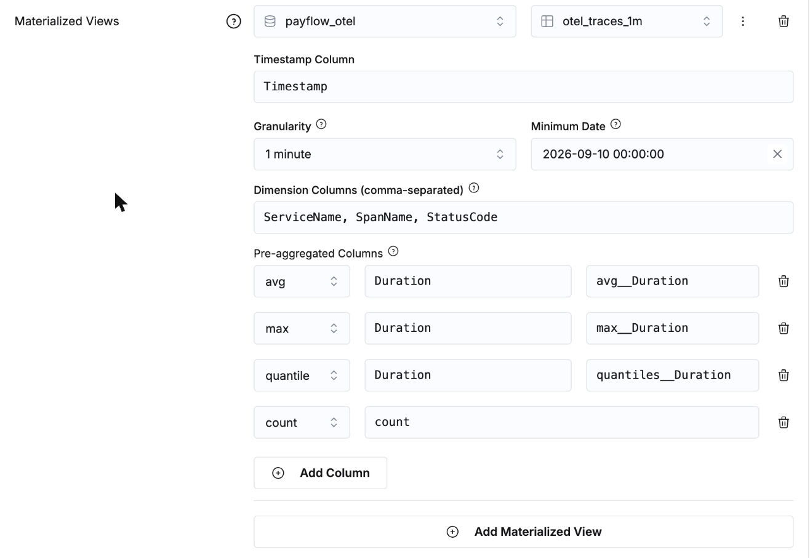
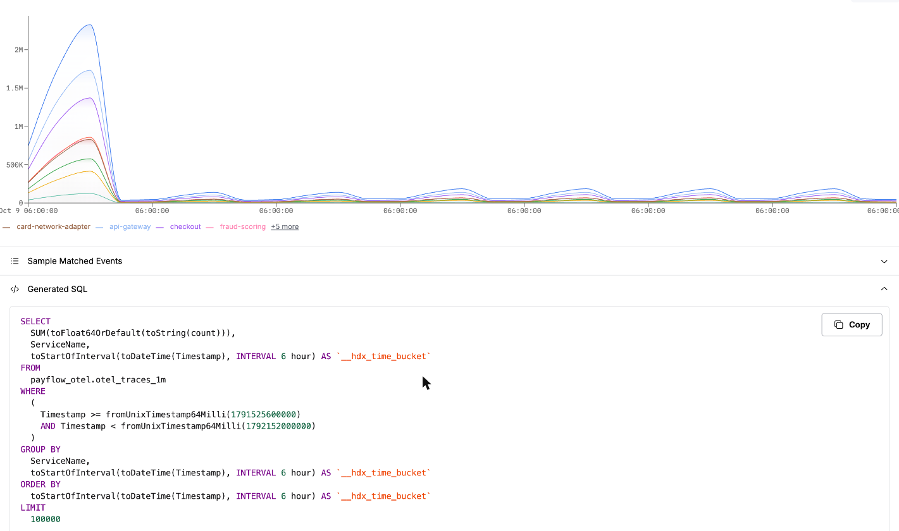

# Module 7 · Échelle et coût

PayFlow tourne dans 8 régions. Ce module fait passer les logs à **875 millions de lignes**, mesure ce que ClickHouse en fait, puis s'attaque à la facture : agrégats (rollups), rétention, échantillonnage.

Durée : 35 min. Trois fichiers SQL, puis une étape dans ClickStack.

| Fichier | Contenu |
|---|---|
| `01_milliard_de_lignes.sql` | deux semaines x 8 régions de logs, écrites en 8 instructions de ~30 s ; stockage et compression par colonne |
| `02_recherche_et_index.sql` | index texte, bloom filter, accès par trace borné dans le temps, projection, cache de requêtes, query condition cache, 3 répliques : chaque requête avec et sans son accélérateur |
| `03_agregats_retention_echantillonnage.sql` | un agrégat (rollup) dans la convention de ClickStack, le coût de chaque signal par jour, les politiques de TTL, le head sampling et l'échantillonnage à la rétention, le dimensionnement |

> Laissez quelques minutes au service après les 8 insertions de `01_milliard_de_lignes.sql` : tant que les merges tournent en arrière-plan, les requêtes du fichier 02 sont 2 à 3 fois plus lentes, et les parallel replicas apportent peu.

---

## Dans ClickStack · Laisser ClickStack utiliser l'agrégat (10 min)

`03_agregats_retention_echantillonnage.sql` crée `payflow_otel.otel_traces_1m` : par minute, service, nom de span et statut, avec les colonnes d'agrégat nommées `count`, `avg__Duration`, `max__Duration`, `quantiles__Duration` (la convention de nommage de ClickStack). Déclaré sur la source, il permet à ClickStack de répondre aux graphiques, aux tuiles de dashboard et aux alertes à partir de 1,7 million de lignes au lieu de 77 millions de spans, sans les modifier.

1. **Team Settings** (menu de gauche), onglet **Data**. Dans la liste des sources, cliquez sur la flèche au bout de la ligne **PayFlow traces** pour l'ouvrir. Laissez tel quel l'interrupteur à droite de chaque ligne.
2. Descendez jusqu'à **Materialized Views**, cliquez sur **Add Materialized View**.
3. La base est déjà `payflow_otel`. Dans **Table**, tapez `otel_traces_1m` et cliquez dessus dans la liste. Le **⋮** à côté propose **View schema**, pour vérifier les colonnes.
4. Remplissez le formulaire (ClickStack ne le devine pas) :
   - **Timestamp Column** : `Timestamp` ;
   - **Granularity** : `1 minute` ;
   - **Minimum Date** : le premier jour de l'historique, `SELECT pf_day(-29)` dans la console SQL (le backfill du fichier commence là) ;
   - **Dimension Columns** : `ServiceName, SpanName, StatusCode` ;
   - **Pre-aggregated Columns**, un **Add Column** par ligne : `avg`, `Duration`, `avg__Duration` ; `max`, `Duration`, `max__Duration` ; `quantile`, `Duration`, `quantiles__Duration` ; `count`, `count` (count n'a pas de colonne source).
5. **Save Source**. Un message *Source updated* le confirme.

> **Attention** : dans ces listes, cliquer sur l'option déjà sélectionnée (avec une coche) la désélectionne. Si l'enregistrement échoue avec `databaseName: Required`, choisissez une autre base, puis de nouveau `payflow_otel`.

Vérifiez :
1. **Chart Explorer**, **PayFlow traces**, **Count of Events**, **Group By** `ServiceName`, plage `Last 7 days`, **Run**. Un badge vert **ACCELERATED** apparaît en haut à droite, et **Generated SQL** (en bas) lit `FROM payflow_otel.otel_traces_1m` avec `SUM(count)`.
2. Tapez maintenant `SpanKind:Server` dans **Where**, **Run** : le badge passe à l'orange, **NOT ACCELERATED**. Cliquez dessus : la vue est **INCOMPATIBLE**, et le panneau liste ce qu'elle peut servir (**Available Group and Filter Columns** : `ServiceName`, `SpanName`, `StatusCode`). `SpanKind` n'est pas une dimension de l'agrégat, ClickStack revient donc aux spans, sans rien dire et sans erreur.
3. Sur une longue plage, le graphique se remplit en plusieurs passes, les jours les plus récents d'abord : attendez qu'il se stabilise avant de le lire.

Règles bonnes à connaître :
- chaque colonne du **Where** et du **Group By** doit être une dimension de la vue : choisissez les dimensions à partir des graphiques que vous voulez accélérer (les tuiles du module 4 filtrent sur `SpanKind` : ajoutez-la à l'agrégat pour les accélérer aussi) ;
- la granularité du graphique doit être un multiple de celle de la vue (vue à 1 min : graphiques à 1, 5, 15, 60 min) ;
- une vue ne contient que ce qui a été inséré après sa création : chargez l'historique, ou fixez la date minimale ;
- commencez par un agrégat par source (comptage et durée par service), une dizaine au maximum.

## Isolation lecture et écriture (à connaître, pas à faire)

Avec un **warehouse**, ClickStack peut tourner sur un second service, en lecture seule, qui partage le même stockage : les dashboards, les alertes et les notebooks ne ralentissent jamais l'ingestion, et chacun passe à l'échelle indépendamment. ClickStack le recommande au-delà d'environ 100 To par mois.
