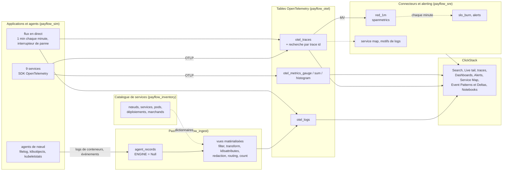

# ClickHouse de zéro à avancé · Workshop observabilité

Black Friday chez **PayFlow**, une plateforme de paiement sur Kubernetes. À 13h58, une nouvelle version fait passer le pool de connexions à la base de 50 à 10. Les paiements commencent à échouer, les retries s'accumulent, un pod est tué faute de mémoire. Vous collectez tous les signaux de cette journée sur **votre propre service ClickHouse Cloud**, vous les explorez dans **ClickStack** (Search, Dashboards, Alerts, Service Map, Event Patterns, AI Notebooks) et vous voyez en dessous, en SQL, comment fonctionne chaque fonctionnalité.

Logs, traces, métriques et événements Kubernetes sont **simulés en SQL** : pas de collecteur, pas de générateur de charge, rien à installer. Ils suivent exactement le schéma OpenTelemetry de l'exporteur ClickHouse, si bien que ClickStack les lit comme si un vrai collecteur les avait écrits. Tout est déterministe : tout le monde obtient les mêmes chiffres. Un flux en direct rejoue du trafic chaque minute, et un interrupteur de panne permet de casser la production exprès.

---

## L'architecture : le chemin de la télémétrie

Le workshop suit le chemin d'une vraie télémétrie, avec le vocabulaire du collecteur OpenTelemetry et de ClickStack. Ce qu'un collecteur ferait en bordure, la passerelle (gateway) le fait dans ClickHouse, avec des vues matérialisées : l'approche que recommande la documentation ClickHouse pour les traitements lourds.



| Base | Rôle | Tables |
|---|---|---|
| `payflow_sim` | les applications et leurs agents, simulés en SQL ; le flux en direct | vues, l'interrupteur de panne |
| `payflow_ingest` | la table d'atterrissage de la passerelle du collecteur (ne stocke rien) | `agent_records` |
| `payflow_otel` | ce qu'écrit l'exporteur ClickHouse : les sources de ClickStack | `otel_logs`, `otel_traces`, `otel_metrics_*`, recherche par trace id, agrégats (rollups) |
| `payflow_sre` | ce que calculent les connecteurs et l'alerting | `red_1m`, `slo_burn`, `alerts`, `service_map_5m`, `log_patterns_10m`, `log_volume_1m` |
| `payflow_inventory` | le catalogue de services, chargé en mémoire sous forme de dictionnaires | `node`, `service`, `pod`, `deployment_history`, `merchant` |

---

## Avant la session (20 min, la veille)

1. **Créez votre compte ClickHouse Cloud** sur [clickhouse.cloud](https://clickhouse.cloud). Vous recevez 300 $ de crédits, bien plus que ce que demande la journée.
2. **Créez un service** avec cette configuration :

   | Paramètre | Valeur | Pourquoi |
   |---|---|---|
   | Région | AWS **eu-central-1** (ou la plus proche de chez vous) | |
   | Répliques | **3** | les gros scans sont répartis sur les 3 (module 7) |
   | Mémoire par réplique | **64 Go** (16 vCPU), **minimum = maximum** | taille fixe : pas d'attente de l'autoscaling pendant une démo |
   | Mise en veille | **après 1 heure** d'inactivité, au minimum | le service ne s'endort pas pendant une pause |

   Coût indicatif : environ 11 $ de l'heure au maximum avec cette taille, moins de 70 $ pour la journée. Le calculateur de [clickhouse.com/pricing](https://clickhouse.com/pricing) donne le tarif exact.
3. **Ouvrez la console SQL** du service et lancez `SELECT version()`. Puis ouvrez une fois **ClickStack** depuis le menu de gauche, pour vérifier qu'il est disponible sur votre service.
4. Facultatif, pour rattraper en ligne de commande : installez le client natif (`curl https://clickhouse.com/ | sh`).

Chaque fichier SQL se lance dans la console SQL, instruction par instruction ou d'un coup. Chaque instruction reste sous les 60 secondes. Chaque fichier se termine par un checkpoint qui doit afficher `OK` partout. Chaque module qui a une partie ClickStack a un README avec les étapes dans l'interface.

---

## Déroulé (5 heures)

| Heure | Module | ClickStack | Le SQL en dessous | Durée |
|---|---|---|---|---|
| 0:00 | **00** Premiers pas | | un million de lignes de log générées, parsées, agrégées en une requête | 10 min |
| 0:10 | **01** Modèle de données | | le catalogue de services et ses dictionnaires ; les tables OpenTelemetry, exactement comme l'exporteur les crée | 25 min |
| 0:35 | **02** Collecte | | les applications et les agents, la passerelle (table Null et processeurs sous forme de vues : parsing, enrichissement, masquage des cartes, filter, count), traces et métriques OTLP, le flux en direct | 40 min |
| 1:15 | **03** Recherche et corrélation | Sources, recherche Lucene et SQL, recherche enregistrée, Live tail, du log à la trace au pod ; trois enquêtes, depuis un log, une alerte métrique, une trace | les index texte, EXPLAIN, les trois scénarios en SQL | 45 min |
| 2:00 | pause | | | 10 min |
| 2:10 | **04** Dashboards | Chart Explorer, un dashboard avec filtres, Release markers, drilldown au clic sur une ligne, tuiles SQL, presets, text-to-chart | agrégats RED (spanmetrics), l'histogramme de latence avec exemplars | 35 min |
| 2:45 | **05** SLO et alertes | alertes sur recherche, sur graphique et SQL, un webhook ; **casser la production et recevoir la page** | budget d'erreur, burn rate, alerting multi-fenêtres | 30 min |
| 3:15 | **06** Enquête | Service Map, Event Patterns, Event Deltas, Release markers, Infrastructure tab | les 10 questions, la trace en arbre, le coût de l'incident | 40 min |
| 3:55 | pause | | | 10 min |
| 4:05 | **07** Échelle et coût | un agrégat (rollup) déclaré sur la source | 875 M de lignes de log : index texte, bloom filter, projection, caches, 3 répliques ; rétention, échantillonnage, dimensionnement | 35 min |
| 4:40 | **08** IA et gouvernance | AI Notebooks, MCP, RBAC | ClickHouse Agents, row policies, suppression RGPD, une API de statut | 20 min |

---

## Rattrapage

En retard, ou un module a échoué ? Le script `run_all.sh` rejoue les fichiers SQL avec le client natif, depuis votre machine, dans le dossier `fr/` :

```bash
cd fr
export CH_HOST=<votre-service>.<region>.clickhouse.cloud
export CH_PASSWORD='<mot de passe>'
```

```bash
./run_all.sh 01 04
```
Rejoue les modules 01 à 04, sans reset.

```bash
./run_all.sh 05_slo
```
Reprend à partir d'un module jusqu'à la fin.

```bash
./run_all.sh
```
Tout depuis zéro, reset compris : environ 10 minutes.

En fin de journée, lancez `arreter_flux_en_direct.sql` : le flux en direct se rafraîchit chaque minute et empêche le service de se mettre en veille. `reset.sql` ne supprime que ce que le workshop a créé : les bases `payflow_*`, l'utilisateur et les rôles, et les fonctions `pf_*`.

---

## Lexique

| Terme | Sens | Terme | Sens |
|---|---|---|---|
| **Signal** | un type de télémétrie : logs, traces, métriques (et sessions dans ClickStack) | **Wide event** | wide event (événement riche) : un enregistrement avec beaucoup d'attributs, forte cardinalité permise |
| **Resource / attributes** | qui a émis (service, pod, nœud) / le détail de l'événement | **Span / trace** | une opération d'une requête / l'arbre des spans d'une requête |
| **Collecteur** | l'agent ou la passerelle OpenTelemetry : receivers, processeurs, exporteurs, connecteurs | **Agent / passerelle (gateway)** | un collecteur sur chaque nœud / un collecteur central qui traite et exporte |
| **Processeur** | une étape du collecteur : filter, transform, k8sattributes, redaction, batch | **Connecteur** | transforme un signal en un autre : spanmetrics (RED), servicegraph, count |
| **ClickStack** | la stack d'observabilité de ClickHouse : ClickHouse, le collecteur, l'interface HyperDX | **Source** | dans ClickStack, une table déclarée comme logs, traces ou métriques |
| **RED** | Rate, Errors, Duration : les trois chiffres d'un service | **SLO / budget d'erreur** | 99,95 % des paiements réussissent / les 0,05 % d'erreurs permises |
| **Burn rate** | taux de consommation (burn rate) : la vitesse à laquelle le budget est consommé ; 14,4 = le budget d'un mois en 2 jours | **Exemplar** | le trace id gardé avec un point de métrique, pour sauter d'un graphique à une trace |
| **Event Patterns / Deltas** | lignes de log regroupées en messages / ce qui distingue les spans lents | **Release marker** | la ligne, sur un graphique, où une nouvelle version apparaît pour la première fois |
| **HikariCP** | le pool de connexions Java à la base ; sa taille est ici la cause racine | **OOMKilled** | tué par le noyau pour avoir dépassé la mémoire permise |
| **PAN** | le numéro de carte, à ne jamais stocker en clair (PCI DSS) | **Moteur Null** | une table qui ne stocke rien ; ses vues matérialisées voient chaque insertion |
| **MV / RMV** | vue matérialisée incrémentale / vue rafraîchissable | **Index texte / bloom filter** | un index des mots d'une colonne / "certainement pas dans ce granule" |

---

## Contenu du dépôt

```
00_premiers_pas/              un million de lignes de log en une requête
01_modele_de_donnees/         le catalogue de services et ses dictionnaires, les tables OpenTelemetry
02_collecte/                  simulateur, pipeline de la passerelle, traces et métriques OTLP, flux en direct
03_recherche_et_correlation/  la recherche ClickStack, trois scénarios de corrélation (README) et le SQL en dessous
04_dashboards/                les dashboards ClickStack (README) et les agrégats RED
05_slo_et_alertes/            les alertes ClickStack et l'interrupteur de panne (README), burn rate SLO en SQL
06_enquete/                   l'incident dans ClickStack (README), service map, motifs, 10 questions
07_echelle_et_cout/           un milliard de lignes de log, index et caches, agrégats, rétention, échantillonnage
08_ia_et_gouvernance/         AI Notebooks, MCP, ClickHouse Agents, RBAC, API de statut (README) ; droits et RGPD
run_all.sh, reset.sql         run complet et nettoyage
arreter_flux_en_direct.sql    arrêter le flux en direct en fin de journée
RESULTATS.md                  chiffres mesurés sur le service de test, module par module
```

## Bonnes pratiques illustrées

| Règle | Où |
|---|---|
| Utiliser le schéma de l'exporteur : ClickStack le lit tel quel | module 1 |
| Les traitements lourds dans la base : table Null et vues matérialisées | module 2 |
| Des dictionnaires pour l'enrichissement (`query-join-use-dictionaries`) | modules 1, 2, 6 |
| Vues matérialisées incrémentales pour les agrégats (`mv-incremental`) ; vues rafraîchissables pour les fenêtres et les jointures | modules 4, 5, 6 |
| Agrégats (rollups) déclarés sur la source, colonnes d'agrégat nommées `<function>__<column>` | module 7 |
| Index texte, bloom filters, projections déclarés dans le CREATE | modules 1, 7 |
| Rétention par partitions entières (`ttl_only_drop_parts`), échantillonnage qui garde les bonnes traces | module 7 |
| Commentaires sur les tables et les colonnes pour les agents (`agent-discovery-schema`) | module 8 |
