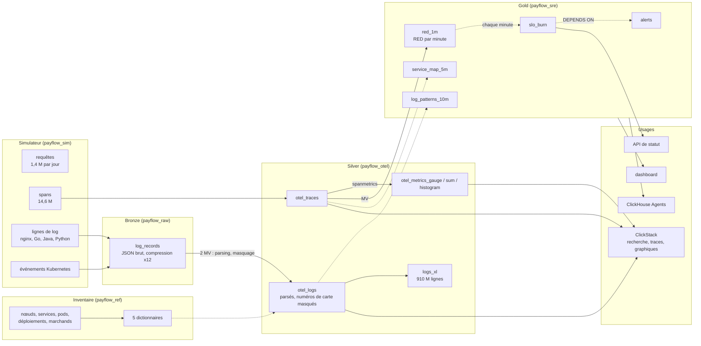

# ClickHouse de zéro à avancé · Workshop observabilité

Black Friday chez **PayFlow**, une plateforme de paiement qui tourne sur Kubernetes. À 13h58, une mise en production fait passer le pool de connexions à la base de 50 à 10. Les paiements commencent à échouer, les retries s'accumulent, un pod est tué faute de mémoire. Vous allez collecter, modéliser et interroger chaque signal de cette journée sur **votre propre service ClickHouse Cloud**, puis mener l'enquête en SQL et dans ClickStack, l'interface d'observabilité de ClickHouse.

Logs, traces, métriques et événements Kubernetes sont **simulés en SQL** (pas de collecteur, pas de générateur de charge, rien à installer) et déterministes : tout le monde obtient les mêmes chiffres. Ils suivent exactement le schéma OpenTelemetry, donc ClickStack les lit comme si un vrai collecteur les avait écrits.

```
 logs conteneurs ──► bronze ──MV──► silver (OpenTelemetry) ──MV / vues rafraîchissables──► gold ──► ClickStack
 événements k8s      JSON brut      otel_logs, otel_traces,     RED, burn rate des SLO,          dashboards
 traces, métriques   (intact)       otel_metrics_*              alertes, service map             API, agent IA
```

---

## L'architecture du workshop

Chaque flèche est du SQL qui tourne dans ClickHouse. Flèche pleine : vue matérialisée incrémentale, déclenchée par chaque INSERT. Flèche pointillée : vue rafraîchissable, recalculée selon un planning.



| Couche | Tables | Ce qu'elle montre |
|---|---|---|
| **Inventaire** | `payflow_ref.*` : 12 nœuds, 9 services, 49 pods, l'historique des déploiements, 20 000 marchands | le contexte auquel chaque signal est joint |
| **Bronze** | `payflow_raw.log_records` | les lignes de log brutes des conteneurs et les événements Kubernetes, intacts, tels que les agents les envoient |
| **Silver** | `otel_logs`, `otel_traces`, `otel_metrics_gauge`, `otel_metrics_sum`, `otel_metrics_histogram` | le schéma de l'exporter OpenTelemetry ; logs parsés depuis 4 formats, numéros de carte masqués |
| **Gold** | `red_1m`, `slo_burn`, `alerts`, `service_map_5m`, `log_patterns_10m` | ce que surveille un SRE, quelques Mo pour toute la journée |
| **Usages** | ClickStack, dashboard de la console SQL, Query API endpoint, ClickHouse Agents | tout lit directement ClickHouse |

---

## Avant la session (20 min, la veille)

1. **Créez votre compte ClickHouse Cloud** sur [clickhouse.cloud](https://clickhouse.cloud). Vous recevez 300 $ de crédits, bien plus que ce que demande la journée.
2. **Créez un service** avec cette configuration :

   | Paramètre | Valeur | Pourquoi |
   |---|---|---|
   | Région | AWS **eu-central-1** (ou la plus proche de vous) | |
   | Répliques | **3** | les gros scans sont répartis sur les 3 (module 6) |
   | Mémoire par réplique | **64 Go** (16 vCPU), **minimum = maximum** | taille fixe : pas d'attente d'autoscaling pendant une démo |
   | Mise en veille | **après 1 heure** d'inactivité, au minimum | le service ne s'endort pas pendant une pause |

   Coût indicatif : environ 11 $ de l'heure au maximum avec cette taille, moins de 70 $ pour la journée. Le calculateur de [clickhouse.com/pricing](https://clickhouse.com/pricing) donne le tarif exact.
3. **Ouvrez la console SQL** du service et lancez `SELECT version()`.
4. Facultatif, pour rattraper en ligne de commande : installez le client natif (`curl https://clickhouse.com/ | sh`).

Chaque fichier SQL s'exécute dans la console SQL, instruction par instruction ou en une fois. Chaque instruction tient sous 60 secondes. Chaque fichier se termine par un checkpoint qui doit afficher `OK` partout.

---

## Déroulé (5 heures)

| Heure | Module | Contenu | Durée |
|---|---|---|---|
| 0:00 | **00** Premiers pas | un million de lignes de log générées, parsées et agrégées en une requête | 10 min |
| 0:10 | **01** Fondamentaux | MergeTree, ORDER BY, LowCardinality ; l'inventaire : nœuds, services, pods, déploiements, marchands | 25 min |
| 0:35 | **02** Bronze | le simulateur SQL, 6 millions de lignes de log brutes en 25 s, exploration du JSON, un problème PCI | 35 min |
| 1:10 | **03** Silver | les tables OpenTelemetry, le pipeline de logs (4 formats, sévérité, trace ids, masquage des cartes), traces, métriques | 40 min |
| 1:50 | pause | | 10 min |
| 2:00 | **04** Dictionnaires | équipe, nœud, marchand, et "quel changement était en production à ce moment-là" | 20 min |
| 2:20 | **05** Gold | métriques RED, burn rate des SLO, alertes, service map depuis les traces, patterns de logs | 35 min |
| 2:55 | **06** Performance | 910 M de lignes de log : index texte, bloom filter, projection, caches de requêtes, 3 répliques | 30 min |
| 3:25 | pause | | 10 min |
| 3:35 | **07** Enquête | de l'alerte à la cause racine en 10 requêtes, le coût de l'incident, rejeu, RGPD, sécurité | 40 min |
| 4:15 | **08** ClickStack et agents | la même enquête dans ClickStack, un dashboard, une API de statut, ClickHouse Agents | 45 min |

---

## Rattrapage

En retard, ou un module a échoué ? Le script `run_all.sh` rejoue les fichiers avec le client natif, depuis votre machine, dans le dossier `fr/` :

```bash
cd fr
export CH_HOST=<votre-service>.<region>.clickhouse.cloud
export CH_PASSWORD='<mot de passe>'
```

```bash
./run_all.sh 01 04
```
Rejoue les modules 01 à 04, sans reset.

```bash
./run_all.sh 05_gold
```
Reprend à partir d'un module, jusqu'à la fin.

```bash
./run_all.sh
```
Tout depuis zéro, reset compris : environ 10 minutes.

`reset.sql` ne supprime que ce que le workshop a créé : les bases `payflow_*`, l'utilisateur et les rôles, et les fonctions `pf_*`.

---

## Lexique

| Terme | Signification | Terme | Signification |
|---|---|---|---|
| **Log** | une ligne horodatée écrite par un programme | **Span** | une opération d'une requête (un appel HTTP, une requête SQL), avec un début et une durée |
| **Trace** | l'arbre des spans d'une requête, à travers les services | **TraceId / SpanId** | les identifiants qui relient logs et spans |
| **Métrique** | un nombre mesuré dans le temps : gauge (une valeur), sum (un compteur), histogram (une distribution) | **OpenTelemetry (OTel)** | le standard ouvert pour les logs, les traces et les métriques |
| **RED** | Rate, Errors, Duration : les trois chiffres d'un service | **SLO** | objectif de niveau de service, par exemple 99,95 % des paiements réussis |
| **Budget d'erreur** | les erreurs que le SLO autorise (0,05 % ici) | **Taux de consommation (burn rate)** | la vitesse à laquelle le budget est consommé ; 14,4 = le budget d'un mois en 2 jours |
| **Exemplar** | le trace id gardé avec un point de métrique, pour sauter d'un graphique à une trace | **Service map** | qui appelle qui, reconstruit à partir des spans parents et enfants |
| **ClickStack** | la stack d'observabilité ClickHouse : ClickHouse, collecteur OpenTelemetry, interface HyperDX | **HyperDX** | l'interface de ClickStack : recherche, traces, dashboards, alertes |
| **Pod / nœud** | un groupe de conteneurs en cours d'exécution / la machine qui l'héberge | **Rollout / rollback** | déploiement progressif : remplacer les pods par une nouvelle version / retour arrière : revenir à la précédente |
| **OOMKilled** | tué par le noyau pour avoir utilisé plus de mémoire que permis | **HikariCP** | le pool de connexions Java à la base ; sa taille est ici la cause racine |
| **PAN** | primary account number : le numéro de carte, à ne jamais écrire en clair dans un log (PCI DSS) | **MV / RMV** | vue matérialisée incrémentale / vue rafraîchissable |
| **Index texte** | un index des mots d'une colonne, pour la recherche plein texte | **Bloom filter** | un index compact qui dit "certainement pas dans ce granule" |
| **Projection** | une seconde copie d'une table, pré-triée ou pré-agrégée, choisie automatiquement | **Granule** | l'unité que lit ClickHouse : 8 192 lignes |

---

## Contenu du dépôt

```
00_introduction/                 premiers pas
01_fondamentaux/                 bases, MergeTree, l'inventaire de la plateforme
02_bronze/                       le simulateur SQL, ingestion brute, exploration du JSON
03_silver/                       tables OpenTelemetry, pipeline de logs, traces et métriques
04_dictionnaires/                enrichissement en mémoire, "quel changement était en production"
05_gold/                         RED, SLO et alertes, service map et patterns de logs
06_performance/                  un milliard de lignes de log, index, projections, répliques
07_investigation/                l'incident pas à pas ; l'exploitation
08_clickstack_dashboards_agent/  README pas à pas : ClickStack, dashboard, API, agent (pas de fichier SQL)
run_all.sh, reset.sql            exécution complète et nettoyage
RESULTATS.md                     chiffres mesurés sur le service de test, module par module
```

## Bonnes pratiques ClickHouse illustrées

| Règle | Où |
|---|---|
| Choisir l'ORDER BY d'après les filtres les plus fréquents (`schema-pk-plan-before-creation`) | modules 1, 3 |
| LowCardinality pour les chaînes répétées, pas de Nullable | modules 1, 3 |
| Vues matérialisées incrémentales pour l'ingestion et les agrégats (`mv-incremental`) | modules 3, 5 |
| Vues rafraîchissables pour les fenêtres et les jointures, `DEPENDS ON`, `SYSTEM WAIT VIEW` | module 5 |
| Dictionnaires plutôt que jointures pour l'enrichissement (`query-join-use-dictionaries`) | module 4 |
| Index de saut (texte, bloom filter) et projections déclarés dans le CREATE | module 6 |
| DELETE léger et opérations sur partitions plutôt que mutations | module 7 |
| Commentaires sur les tables et les colonnes pour les agents (`agent-discovery-schema`) | module 8 |
